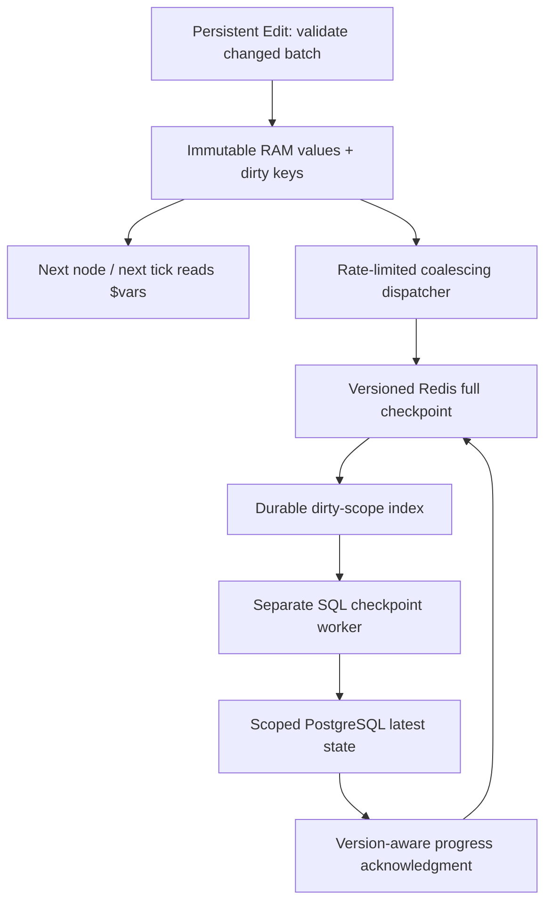

# Coreza live variables — coalesced RAM-first checkpoint plan

Date: 13 October 2026  
Status: DESIGN / IMPLEMENTATION PLAN ONLY; runtime flag remains disabled  
Target: `Coreza-io/coreza`, branch `dev`  
Reviewed baseline: `ca014c3595d284ae486194a41eb057aa858208db`

## 1. Decision and scope

Use **runner-local immutable values + a bounded dirty-key map + periodic full-state Redis checkpoint + slower PostgreSQL checkpoint** for replaceable live workflow variables. Do not enqueue a mutation event, promise, Redis Stream entry, or BullMQ job for each tick. The SQL worker persists the latest coherent snapshot rather than reconstructing every intermediate assignment.

This document consolidates and replaces the attached superseding update and historical plan below it. Earlier per-mutation queues, contiguous mutation-log replay, and per-tick receipt journals are not implementation requirements for replaceable state. The same applies to the earlier separate technical specification's event-outbox recommendation. Historical durability concerns remain relevant, but the chosen mechanism is a versioned checkpoint, not an ordered mutation log.

The updated coalescing direction is appropriate. The refinements here make transport selection, acknowledgment races, bounded scheduling, byte validation, ownership, recovery and rollback concrete. Redis configuration and real throughput remain deployment checks; this review did not run application tests or measure production latency.

Authoring stays Edit Fields → Persistent ON. Retrieval stays `{{ $vars.bonus }}`. Typed staging remains all-or-nothing; downstream nodes and later ticks read immediately from RAM. Persistent OFF leaves `$vars` unchanged. No parser changes, variable settings page, Get Variable node, or unrelated cluster changes.

Only **replaceable current-state** is eligible. Order commands, fills, position transitions, audit trails, once-only actions and event histories remain on their existing durable execution paths. V1 should keep strategies using variables as authoritative trade-critical recovery state on the synchronous path. Do not infer criticality automatically from a variable name. Eligibility is an explicit server-side strategy policy/allowlist; unknown classification means write-behind disabled.

## 2. What was verified in Coreza `dev`

The file blobs read during this review match the pinned baseline tree for the files inspected. These are code facts, not assumptions about the deployed infrastructure.

| Component | Verified behavior | Required change |
| --- | --- | --- |
| `engine/workflowRun.ts` | `initialize()` loads SQL-verified variables; non-backtest commit awaits SQL before publishing; variables survive runtime bar reset | Add live-only recovery/state route; preserve other modes |
| `engine/executionRuntime.ts` | Commit signature already supports `void` or Promise; later contexts refresh from `getVariables`; token uses event/node/invocation | Ordinary live branch can remain synchronous; do not create a new per-tick async wrapper |
| `nodes/executors/ControlFlowExecutor.ts` | Stages typed fields first and awaits only Promise-like commits; Parallel Loop with variables is blocked | Reuse this path and guard |
| `variables/contract.ts` | Scalars only; 128 keys, 4,096 bytes/value, 65,536 bytes/entries snapshot; `overlayVariables` calls whole-snapshot stringify/validation | Add measured incremental live accounting; keep existing contract for persisted loads and other modes |
| `variables/VariableSnapshotService.ts` | No-op check exists; aggregate validation precedes SQL; cache is optional revision-keyed Redis | Keep legacy behavior; live checkpoints need a separate namespace and loader |
| `variables/VariableRepository.ts` | Uses owner/workflow RPCs and expected SQL revision | Add scoped checkpoint RPC; do not pass live generation as legacy revision |
| `services/WorkflowRunner.ts` | Sequential processing inside one runner; initializes before stream reclaim; run creation/status/ACK already await Redis | Remove variable I/O wait only; do not claim the complete tick becomes network-free |
| Same runner | `stop()` aborts and immediately destroys engine; failures are recorded and then source event is ACKed | Add bounded variable drain before destroy and explicit safety-stop handling |
| `services/workflowRunnerManager.ts` | Runner map is process-local and keyed by workflow; no distributed writer fence in this module | Add verified cross-process scope ownership; local map is insufficient |
| Existing migration | Uses owner-global revision lock and stores growing JSONB `commit_receipts` | Live path must not use per-mutation legacy receipt storage |
| `config/redis.ts` | Separate queue/cache clients; queue retry limit is unlimited and stream client permits offline buffering; cache fails fast | Add bounded checkpoint client using verified durable topology without changing BullMQ settings |
| `AGENTS.md` | Current rule requires awaited SQL and cache-only variable infrastructure | Implementation must update that rule to explicitly permit live-only checkpoint semantics; other modes retain current rule |

The reviewed runner and manager do not establish a distributed writer fence. Other services or deployment controls might provide one; implementation discovery must verify this before claiming platform-wide absence. A BullMQ job lock on ordinary workflow jobs is not proof that a long-lived live runner is uniquely owned.

## 3. Semantics and consistency contract

Scope is `(authenticated ownerId, workflowId)` with one active live writer in v1. `executionId` identifies a session but is not a durable fence. Restart creates a new explicitly linked epoch after resolving the old checkpoint. Multiple concurrent live instances for the same scope require separate namespaces and a reviewed aggregation/inheritance contract; do not permit them implicitly.

Maintain independent versions:

- `legacySqlRevision`: existing owner-global configuration revision, unchanged in meaning.
- `epochId`: immutable session generation identity; never ordered lexicographically or by timestamp.
- `writerFence`: SQL-assigned monotonic ownership number.
- `localGeneration`: increment once per changed validated Edit batch within an epoch.
- `redisAcceptedGeneration`: latest full snapshot received by Redis.
- `sqlCheckpointGeneration`: latest full snapshot committed by SQL.

Use BIGINT internally and decimal strings on wire; do not compare BIGINT decimal strings lexicographically or convert them through JavaScript/Lua floating-point numbers.

Within the active epoch, SQL ≤ Redis accepted ≤ RAM generation. Generation gaps are **expected** because intermediate states are coalesced: Redis can accept generation 10 and then 100. Neither worker nor recovery requires generations 11–99. A full snapshot is self-contained and must preserve whole-batch consistency. Different epochs require verified SQL lineage/fence state, not simple max-generation selection.

| Execution mode | Mutation semantics |
| --- | --- |
| Eligible live + both feature flags enabled | Immediate RAM acceptance; asynchronous checkpoint |
| Live flag disabled or strategy ineligible | Existing awaited SQL path |
| Manual / cluster | Existing awaited SQL transaction when scope is available |
| Backtest | Ephemeral overlay, no production writes |
| Preview | Read-only authorized snapshot, no writes |

Concurrent manual/cluster writes to a live-owned scope must be rejected at the shared SQL write boundary, or performed only after an explicit stop/flush/handoff. Retaining their awaited commit behavior does not make competing writes safe. A manual/cluster run after live stop must read the latest transferred checkpoint. Preview must identify whether it shows SQL-checkpointed state or a read-only Redis-received snapshot; it cannot claim to see unflushed runner RAM.

Successful live Edit means local acceptance. It does not mean SQL durability. Report epoch/local/Redis/SQL versions separately in authorized runtime metadata, without putting the variable registry into graph/run output history. Preserve `variable_revision` as the legacy revision; add explicit checkpoint metadata instead of changing its meaning.

## 4. Architecture and rate model



The live process needs a lightweight I/O dispatcher because a separate worker cannot read its local JavaScript memory. The SQL worker is a distinct process/role using the existing worker deployment framework. Neither requires a BullMQ job per tick or per variable.

Proposed starting cadences: RAM → Redis 250 ms; Redis → SQL 2 seconds. These are benchmark candidates, not latency guarantees. One timer/wake handle per active scope is sufficient; callbacks only schedule bounded work. Use a central fair scheduler if scope counts make individual timers expensive.

For a continuously changing scope, these candidates imply approximately 4 logical Redis checkpoint writes/second and 0.5 SQL checkpoint transactions/second, irrespective of 100 or 10,000 local mutations/second. Reads, index operations, retries, lease renewal and progress checks add operations; count them separately. Enforce write-attempt rate limits even when dirty-size/age thresholds trigger. Do not create an immediate-flush loop on every completion while updates continue.

At the 64-KiB entries limit, four full checkpoints/second carry about 256 KiB/second/scope before envelope and protocol overhead. For 100 such scopes that is about 25 MiB/second payload, demonstrating why global scope/throughput budgets matter. Measure real snapshot sizes; begin with full snapshots and add delta complexity only if observed write amplification justifies it.

Background I/O does not have to keep up with every assignment: it replaces the checkpoint with the latest state. It must meet checkpoint-age and resource budgets. Serialization still executes on the Node.js event loop, so async I/O alone does not guarantee tick latency. Measure event-loop lag and ensure the live loop yields for timers. Do not introduce worker threads or persistent-map dependencies before benchmarks show they are needed.

## 5. Runner-local state and mutation algorithm

Proposed `LiveVariableState` contains:

```ts
interface LiveVariableStateData {
  scope: { ownerId: string; workflowId: string; epochId: string; fence: bigint };
  values: Readonly<Record<string, VariableValue>>;
  entriesByKey: Map<string, Readonly<VariableEntry>>;
  entryBytesByKey: Map<string, number>;
  entriesEncodedBytes: number;
  localGeneration: bigint;
  redisAcceptedGeneration: bigint;
  sqlCheckpointGeneration: bigint;
  eligibleGeneration: bigint; // last settled source-event snapshot
  dirty: Map<string, { generation: bigint }>;
  inFlight?: CapturedCheckpoint;
  lifecycle: 'recovering' | 'active' | 'paused' | 'quiescing' | 'stopped';
}
```

Dirty metadata points to current immutable values; it does not retain every prior value. Memory scales with variables/scopes plus a fixed number of captured snapshots, not tick count. A flush captures immutable entries/snapshot at one generation. Copy-on-write publication keeps earlier snapshots valid.

Synchronous `apply(changes)`:

1. Use existing typed field staging and validation before touching state.
2. Check lifecycle, confirmed lease deadline, and live strategy eligibility.
3. Compare key existence and scalar equality. `null`, `false`, `0`, negative values and empty strings are valid; absent differs from null. Repeated identical assignments allocate no generation or flush work.
4. Validate key/type/value limits and the **proposed aggregate** using incremental byte accounting. Compute encoded bytes only for changed scalar/entry data; do not stringify the whole registry.
5. Reject the whole batch if count/bytes/process budget fails. Existing Persistent Edit deletion semantics are not expanded.
6. Prepare the copy-on-write values map and changed immutable entries. Increment generation once for the batch.
7. Publish new values and update dirty metadata atomically in a non-awaiting critical section. No network, per-tick queue item, timer, persistence promise, or full-checkpoint hash.
8. Return through the existing synchronous `void` commit branch. Downstream contexts use the runner's newest immutable values.

At most 128 scalar properties are copied on a changed batch in the simple v1 implementation. This is still O(variable count) CPU per changed batch. The statement “no full-map cloning every tick” cannot mean zero copying if every tick actually changes a flat immutable map. Guarantee no cloning on reads/no-ops, no repeated full JSON serialization, and measure changed-batch copying. Consider structural sharing only if that bounded copy fails performance acceptance.

### Aggregate byte accounting

The existing 65,536-byte limit applies to the encoded **entries array**, including keys, types, timestamps, JSON escaping and separators, not merely summed raw scalar sizes. Cache each entry's encoded size at admission and maintain array overhead exactly. Validate changed entries with the same serialization form used by checkpoint encoding. Scalar-only JSON encoding is permitted for exact validation; the forbidden expensive operation is whole-snapshot encoding per tick.

The PostgreSQL migration validates JSONB text size, whose whitespace/number representation can differ from JavaScript serialization. Define a consistent authoritative size contract or a conservative admission bound and test edge cases against actual PostgreSQL/Supabase. Do not declare the current byte counters exact across both encodings without proving it. Include separate bounded envelope metadata allowance. Revalidate complete snapshots on Redis recovery and in the SQL RPC.

## 6. Capture, acknowledgments and dirty-age safety

Use one active dirty map with per-key generation metadata and one immutable in-flight snapshot. There is no need to clone a second dirty map or queue snapshots. New mutations overwrite key metadata while the captured snapshot remains unchanged.

At flush start, synchronously capture `(scope, eligibleGeneration, last-settled immutable entries, capture time)` without an await between reading version and entries. Serialize/hash the complete captured snapshot once inside the dispatcher. Admission continues while network I/O awaits. In-event mutations remain visible immediately in RAM, but become checkpoint-eligible only when that event settles. Dirty acknowledgments clear only keys covered by this eligible generation.

For acknowledgment of captured generation G:

- confirm exact epoch/fence and accepted payload identity;
- advance only the corresponding generation watermark;
- clear a dirty key only if its current mutation generation ≤ G and its current value matches the captured value;
- never clear a generation G+1 key, including A→B→A changes that happen to end at the old value;
- keep newer mutations for the next scheduled flush.

SQL generation G acknowledgment similarly cannot mark G+1 checkpointed. The local dirty map tracks **Redis-pending** state; SQL lag is tracked separately. A clean local dirty map does not mean SQL durability.

Timeouts are ambiguous remote outcomes. Do not retry with a new version and claim the old operation cancelled. Retain one unresolved captured snapshot until its outcome is reconciled using idempotent CAS/readback; only then capture a newer checkpoint. A `Promise.race` timeout does not cancel an ioredis command. Disconnect/retire the dedicated client when appropriate, retain a fixed-size ambiguous receipt, and reconcile before continuing. Version guards must protect against a delayed original command.

Do not reset persistence-age timers every time a hot key changes: that would conceal an outage indefinitely. Track last verified checkpoint coverage and start of the unresolved coverage interval. For Redis, the monotonic capture time of the last acknowledged full snapshot provides a conservative coverage-age bound while dirty. A new generation being acknowledged refreshes coverage to its captured time, not its acknowledgment completion time. For SQL, use trusted checkpoint progress/capture metadata with clock uncertainty accounted for, plus a no-progress timeout. Latest mutation time alone is insufficient.

## 7. Chosen Redis protocol

Choose **versioned full checkpoints plus a coalesced dirty-scope index** as v1 default. A Stream per flush is a fallback only if deployment constraints require it; it introduces retained payload backlog that latest-value storage avoids. Do not implement both transports initially.

Use the verified non-evictable, persistence-capable queue topology, with a dedicated bounded checkpoint client. An evicting cache or expiring checkpoint is not authoritative recovery storage. Existing revision-keyed cache keys remain unchanged. Confirm Redis version, AOF, replication, Sentinel behavior, storage quotas and ACLs before enabling.

Example fixed-bucket Redis Cluster layout:

```text
coreza:livevars:{lv:<bucket>}:scope:<scopeHash>:checkpoint
coreza:livevars:{lv:<bucket>}:scope:<scopeHash>:authority
coreza:livevars:{lv:<bucket>}:dirty
```

Hash the owner/workflow tuple into a fixed bucket and member identity. The checkpoint/authority keys and bucket dirty SET share a hash tag, allowing atomic same-slot scripts. One SET member per dirty scope; no generation-specific members or growing queue. Validate owner/workflow binding from trusted authority metadata; hashes do not replace authorization.

The checkpoint holds bounded version metadata and full encoded entries plus a canonical payload hash. No TTL until explicit safe retirement/deletion. Generations/fences are decimal strings; Lua compares canonical decimal strings by length then lexical order, or uses a safe bounded representation proven not to lose precision. Never use `tonumber()` for arbitrary BIGINT versions.

### Publish script

Validate scope/epoch/fence, lease validity, lifecycle, schema/payload limits and existing key types before writes. Reject an old fence or different unauthorized epoch. For the same epoch:

- higher generation: replace full checkpoint and mark scope dirty;
- same generation, same hash: idempotent receipt; ensure any missing dirty marker is repaired if SQL is behind;
- same generation, different hash: corruption; stop scope;
- lower generation: stale result, not successful persistence of the caller's newer RAM.

Order mutations to avoid false clean state if a script errors: add the dirty marker before the final checkpoint replacement after preflight; workers tolerate redundant dirty markers. Redis scripts isolate execution but do not automatically roll back earlier mutations on a runtime error. Fault-test partial effects and recovery. Same-slot atomicity does not create a SQL+Redis distributed transaction.

### Worker acknowledgment script

After SQL commits generation G, update trusted SQL progress monotonically. Remove the dirty-scope member only if the checkpoint still has the exact epoch and generation committed (or an explicitly verified SQL-ahead reconciliation). If Redis advanced to G+1 during SQL I/O, retain the member. This prevents generation-20 completion losing generation 21. Marker removal is compare-and-remove, never unconditional `SREM` after a stale read.

Pub/Sub may wake a scheduler but is optional and never the sole delivery mechanism. Worker startup and periodic bounded `SSCAN` of bucket dirty sets recover missed notifications. Maintain fair scan cursors across pages and bounded per-scope in-flight flags; hot scopes must not starve others. After Redis failover/index corruption, reconcile checkpoint keys and SQL scope inventory in bounded pages to repair markers. Missing authoritative payloads cause the configured loss/recovery decision, not automatic deletion.

Redis-received is distinct from disk durability. AOF/replication settings govern recovery guarantees; `WAIT` is replication acknowledgment, not strong consistency, and `WAITAOF` requires supported/configured deployment. If used in background, verify returned acknowledgment counts on the write connection. Expose a separate Redis-durable level only when actually confirmed.

## 8. SQL worker, checkpoint schema and compatibility

One outstanding SQL transaction per scope, bounded global concurrency, and at most one pending ready-scope marker. Select the latest Redis snapshot when the scope's SQL cadence is due; do not schedule a SQL job for every Redis publish. Intervening snapshots can be superseded.

The worker validates complete payload scope/hash/types/limits, then calls a workflow-scoped restricted RPC. The transaction locks scope ownership and checkpoint rows in a fixed order, verifies the epoch/fence or approved sealed-epoch recovery permission, and conditionally commits a higher generation. Same version/hash is a no-op; conflicting hash fails. Generations need not be contiguous. No JSONB per-mutation receipt accumulation.

Proposed additions:

| Relation / fields | Purpose |
| --- | --- |
| `workflow_live_variable_state`: owner+workflow PK; snapshot, epoch, fence, generation, payload hash, source coverage metadata | Compact latest durable checkpoint |
| Scoped authority/epoch fields or separate compact scope row: writer, lease, lifecycle phase, parent checkpoint, recovery transition | Single-writer ownership and resumable restart |
| Optional bounded sealed-epoch metadata | Only if required for transition/recovery; prune after verified handoff |

Reuse existing typed `workflow_variables` representation where it reduces work, but **do not checkpoint every flush through the existing owner-global revision/receipt RPC**. A compact scoped live-state row separates live generation from the legacy owner revision. RLS/restricted RPCs validate workflow ownership even for service-role calls. No direct client writes or raw values in telemetry.

Prefer legacy row synchronization at explicit handoff rather than every live checkpoint. While live mode owns a workflow, read-only/manual startup routing must know the active state source. On stop or mode switch, checkpoint and transfer final values into the existing scoped `workflow_variables` under exclusive ownership, advancing legacy revision once and invalidating the scoped legacy cache. Preserve global rows and historical receipts. This adds new checkpoint infrastructure while keeping the existing authoring namespace; it is not a second authoring registry.

Required backend compatibility change: reject legacy Persistent SQL commits for a live-owned scope in the shared RPC, including alternate/manual writers. Scope checks must share the authority lock. On flag rollback, existing guards remain until the live state is drained/transferred. Implementation must also update `AGENTS.md` and the workflow variables documentation to record the live-only exception.

If PostgreSQL is down, Redis keeps one latest full checkpoint per scope and one dirty marker, so variable storage does not grow with ticks or outage duration. Checkpoint-age limits still pause strategies; no infinite degraded trading. Cap scopes and worker tasks to bound total memory. Database WAL/backups/storage still need ordinary capacity monitoring even with a fixed number of logical rows.

## 9. Ownership, recovery and source event semantics

Use SQL as durable ownership/fence authority, or reuse an existing ownership service only if it meets equivalent guarantees. One owner/workflow writer, lease renewed outside tick execution; every hot-path admission checks confirmed local lease deadline. Redis publish checks installed epoch/fence/lease. SQL commits check authority in the same transaction as update.

Proposed lease 15 seconds, renewal 5 seconds, conservative 2-second stop margin. These are test candidates. Use database time for lease authority and a monotonic local deadline adjusted for request delay. Clock timestamps never decide snapshot ordering. SQL RPC must distinguish snapshot persistence by the checkpoint worker from writer admission: a stopped/expired epoch's accepted checkpoint remains recoverable under explicit recovery authority.

A stale writer must stop tick/order admission, not merely fail Redis writes. Verify existing order gateway ownership enforcement. Variable fencing alone cannot prevent a paused process resuming and submitting a broker order. Until that is proved, do not enable automatic multiworker failover for these strategies.

### Resumable restart protocol

1. Acquire exclusive SQL recovery ownership with a higher fence. Record `RECOVERING`; ticks remain blocked.
2. Atomically seal the previous Redis writer epoch and capture its final received full snapshot/version. Late old-writer publish commands are rejected after this boundary.
3. Compare SQL and sealed Redis checkpoints: validate owner/workflow, lineage, schema/hash and versions. Pick the newer valid **complete** checkpoint within the authorized epoch. No mutation-log replay or generation-gap check is needed.
4. Checkpoint the selected old-epoch state under the new recovery authority. Do not reject it merely because its producer fence is old.
5. Create a child epoch at generation 0, referencing the recovered parent version/hash. Initialize Redis with the new fence/base snapshot.
6. Set ACTIVE only when SQL and Redis authority agree; hydrate runner RAM before market-stream reclaim/consumption.

Cross-store transitions are persisted phases with idempotent steps; there is no atomic SQL+Redis transaction. Crash after any step resumes that phase. Missing/corrupt Redis or unexpected lineage blocks startup unless explicit ordinary-state loss policy authorizes recovery from SQL. SQL ahead of Redis can be legitimate after Redis rollback; do not republish blindly without resolving topology/ownership.

A dead runner's RAM-only tail can be lost and its exact generation count may be unknown. 250 ms is a flush cadence, not a guaranteed maximum loss window: timer delay, network latency and outages extend it. Record maximum permitted unresolved coverage age and Redis's separate persistence loss contract. Require production policy sign-off rather than treating design approval as an accepted loss budget.

### Market events and idempotency

The current SQL path has durable invocation receipts. Coalesced replaceable checkpoints intentionally do not retain every invocation. Consequently **do not claim the old per-invocation replay guarantee is preserved** for non-idempotent assignments such as `$vars.counter + 1` when source events can be reclaimed.

V1 uses a settled-event publish barrier: retain one immutable last-settled snapshot and its generation/source outcome; update it when the event finishes. Capture checkpoint state from that snapshot, rather than halfway through a source event, while downstream RAM remains immediate. Distinguish successful completion from a terminal failure/cancellation and never label a partial failed event fully successful. A safety-stop failure can flush accepted state as failed/uncertain coverage for diagnosis and recovery, but cannot authorize automatic source skipping. This requires at most one additional snapshot, not an event queue. Long-running events extend the eligible checkpoint/loss window; bound event duration or keep such strategies ineligible rather than bypassing the barrier silently.

Verify current event retry semantics: the inspected runner can leave run-creation failures pending, ACKs ordinary execution failures, and performs only an initial reclaim batch. Do not infer exactly-once processing or sufficient recovery from that alone. Preserve existing broker-side deduplication/reconciliation. Variable source coverage is diagnostic and a prerequisite for a reviewed replay boundary, not permission to skip pending market events that may contain uncompleted orders.

For v1, strategies requiring exactly-once increments or atomic variable/order recovery remain ineligible unless the existing source cursor/order protocol proves safety. Do not add a per-tick receipt journal back into this plan to conceal the semantic difference. Any critical durable barrier is a separate reviewed path and is excluded from normal write-rate guarantees.

## 10. Stop, backpressure and scheduling limits

Recommended initial candidates to measure:

| Control | Candidate | Enforcement |
| --- | --- | --- |
| Redis checkpoint cadence | 250 ms, tune 100–500 ms | Per-scope rate limiter; one unresolved publish |
| SQL checkpoint cadence | 2 s, tune 1–5 s | Per-scope next due time; one transaction |
| Variable bounds | Existing 128 / 4 KiB / 64 KiB entries | Admission before publication |
| Redis unresolved coverage | Warn 1 s; pause 2 s | Never reset on new mutations |
| SQL checkpoint lag | Warn 15 s; pause 30 s | Verified progress/coverage, not dirty key count |
| Shutdown deadline | 10 s | Explicit local/Redis/SQL status |
| Retry backoff | 100 ms → 5 s, jitter | Global/per-scope rate caps |
| Global active scope/concurrency/bytes caps | Set from baseline/capacity | Reject admission/start before allocating excess work |

No per-tick threshold may bypass persistence rate limits. Normal steady-state attempt count over interval T is bounded by configured cadence/token budget; retry and lifecycle attempts are separately bounded/reported. A global scheduler caps simultaneous network tasks, encoded bytes in flight, connection pool size and active dispatchers. Reuse bounded clients rather than one connection per dirty key.

Redis outage leaves dirty state coalesced. On coverage/lease threshold, pause the strategy before another node/event/order can run; retain pending state and permit background reconciliation. Do not skip a failed Persistent update and silently continue. Distinguish a pause requiring recovery from an ordinary node error that the current runner would simply record and ACK. Resume only with verified ownership and current checkpoint status.

Graceful stop order:

1. Block new intake/admission; wait for the active event or stop it according to existing cancellation policy.
2. Capture the final accepted target generation after the event settles; seal it against further mutation.
3. Reconcile any in-flight publish, flush the final snapshot, and request priority SQL checkpoint within a bounded lifecycle budget.
4. Wait for SQL through the target when required by clean-stop/rollback policy. Return explicit watermarks and timeout/unsaved state.
5. Transfer to legacy representation when leaving live mode, then release writer ownership and destroy engine/close clients.

Keep persistence drain independent of the execution abort signal; current abort-before-destroy code would otherwise cancel the work needed to save accepted state. Do not clean live checkpoint keys using broad execution-key deletion. A timeout leaves recovery metadata intact, marks stop incomplete, and never reports fully durable. Late callbacks may update only the captured epoch/version; lifecycle invalidation prevents them marking a child epoch persisted.

## 11. Focused implementation phases

### Phase 0 — baseline and policy

Verify pinned call paths, actual source event/ownership/order behavior, Redis durability settings, checkpoint client cancellation semantics, Supabase RLS/RPC behavior, schema sizes and legacy/manual contention. Measure current changed-write/no-op/tick latency. Record eligibility, loss budget, retry/recovery boundaries and initial resource caps. No speculative engine rewrite.

### Phase 1 — pure local state

Add `LiveVariableState` around existing variable values, with incremental limits, copy-on-write changed batches, generations, dirty map, coverage metadata, lifecycle and capture/ack APIs. Keep `commitVariables` synchronous for ordinary eligible live writes. Test map boundedness and races before integrating I/O.

### Phase 2 — checkpoint transport

Add `LiveVariableDispatcher` and bounded client factory, fixed-bucket keys, fenced publish and compare-ack scripts, one in-flight snapshot, explicit ambiguity reconciliation and fair rate limits. No BullMQ per tick; no full serialization on reads.

### Phase 3 — SQL worker/schema

Add compact scoped checkpoint/authority state and restricted RPCs; dedicated `LiveVariableCheckpointWorker` enumerates dirty scopes, coalesces SQL writes and conditionally acknowledges progress. Bound work and recovery scans. Extend existing infrastructure rather than creating a second queueing platform.

### Phase 4 — ownership and recovery

Add `LiveVariableRecovery` resumable handoff; resolve source coverage/eligibility; block consumption until newest valid checkpoint is hydrated. Scope guard applies to legacy manual SQL writes too. Prove stale writer rejection across processes and existing order safety.

### Phase 5 — live wiring and compatibility

Both `WORKFLOW_VARIABLES_ENABLED` and new `LIVE_VARIABLE_WRITE_BEHIND_ENABLED` must allow the feature; new flag defaults false. Wire runner initialization, node context, bar reset preservation, metadata, pause and flush-before-destroy. Preserve manual/backtest/preview paths, namespace/parser/UI. Update architecture/docs rules.

### Phase 6 — load/failure tests and rollout

Deploy schema/read guards first, then backend with flag off. Canary ordinary replaceable strategies with explicit eligibility. Enable only after deployed failure/recovery/latency tests. Rollback pauses intake, flushes/reconciles newest checkpoint, transfers legacy rows, invalidates caches and then enables synchronous execution. Flag-off alone is not rollback; preserve schema/guards and checkpoints until recovery is complete.

## 12. Expected file scope

| Existing/proposed path | Responsibility |
| --- | --- |
| `coreza-backend/src/engine/workflowRun.ts` | Live state/recovery route, synchronous admission, lifecycle hooks |
| `coreza-backend/src/engine/executionRuntime.ts` | Keep refreshed local values; expose coverage hooks only if needed |
| `coreza-backend/src/nodes/executors/ControlFlowExecutor.ts` | Keep staged validation and synchronous-or-awaited dispatch |
| `coreza-backend/src/variables/contract.ts` | Shared scalar contract; live incremental byte validation without broad parser changes |
| New files under `coreza-backend/src/variables/` | Local state, dispatcher, recovery, checkpoint repository |
| `coreza-backend/src/variables/VariableRepository.ts` and `VariableSnapshotService.ts` | Compatible source routing and scoped RPC access |
| `coreza-backend/src/config/redis.ts`, `infra/redisKeys.ts` | Bounded dedicated client and same-slot checkpoint/index namespace |
| `services/WorkflowRunner.ts`, `services/workflowRunnerManager.ts` | Lease/recovery gating, coverage/pause, drain before destruction |
| New checkpoint worker plus worker lifecycle wiring | Coalesced SQL schedule, startup reconciliation, bounded shutdown |
| New Supabase migration | Scoped checkpoint/authority RPCs, legacy scope guard, RLS/indexes |
| `AGENTS.md`, `coreza-backend/docs/workflow-variables.md` | Explicit live-only semantics and operations contract |
| Existing persistent variable tests plus new focused tests/benchmark | Preserve regression coverage; prove new protocol |

## 13. Acceptance scenarios

1. 10,000 updates to one variable before flush leave one dirty key. Following node/tick reads the latest value; no persistence jobs/promises are created per mutation.
2. 100 dirty variables remain within the existing contract and publish one full checkpoint. Storage/task count scales with scopes/cadences, not ticks.
3. No-op assignments allocate no generation, dirty metadata, Redis publish or SQL write. Reads/reset remain network-free.
4. Invalid field/count/byte batch publishes nothing. Scalar edge cases and JSON escaped/unicode/number representations preserve validation parity with SQL.
5. Captured generation 20 acknowledged after mutation 21 clears only covered keys; A→B→A and multirow batch races remain safe.
6. Old Redis/SQL versions cannot replace newer state; equal version with unequal hash fails. BIGINT versions above 2^53 compare correctly in JavaScript, Redis scripts and SQL.
7. Lost append response, timeout with command still running, late callback, connection replacement and partial Redis script failure produce bounded retry/reconciliation, not duplicate tasks.
8. SQL commits G while Redis advances to G+1: dirty marker remains and later SQL reaches G+1. Lost notification/worker restart recovers via index scan.
9. Continuous updates during Redis outage cannot reset dirty age; stop threshold fires deterministically. SQL outage retains one latest checkpoint/member per scope and bounded work.
10. Two processes compete; stale fence rejected; lease expired; restart crash after every transition phase; newest valid parent checkpoint restored before ticks.
11. Missing/corrupt Redis, missing index marker, SQL-ahead Redis rollback, invalid epoch and hash conflict fail closed or follow explicit approved ordinary-loss recovery policy.
12. Stop during active flush drains the final settled target or returns explicit pending status; late generation completion never marks newer state durable.
13. Manual/cluster still await SQL when free; concurrent live ownership is safely refused. Backtests produce no live writes; preview remains read-only; flag-off legacy tests pass.
14. Source reclaim/retry tests expose non-idempotent increment behavior and order boundaries; no exactly-once trading or receipt equivalence is claimed from checkpointing.
15. Synthetic load exceeding 10,000 mutations/ticks per second is **generated**, with measured p50/p95/p99, CPU/heap/GC/event-loop lag, fixed dirty count and bounded write-attempt rates. Do not report target throughput as achieved until measured.
16. End-to-end real runner tests separately measure its existing run-record/status/ACK Redis calls; removing variable I/O does not promise 10,000 full workflow executions/sec.
17. Multi-scope full-size snapshots measure payload/operations and prove fair global caps, no starvation, bounded clients and memory stabilization.
18. Deployed Redis restart/AOF/Sentinel and actual PostgreSQL multi-connection RLS/CAS checks prove the configured recovery contract. Unit mocks/PGlite alone are insufficient.

Extend the existing persistent tests rather than replace them. For performance compare synchronous SQL baseline, unchanged-write path, naive existing overlay path and new coalesced path under the same workload. Set acceptance thresholds from measured baseline and product SLO; publish actual results and remaining uncertainty. This documentation update itself requires content/diff checks, not an application test run.

## 14. Observability, readiness and references

Track epoch/local/Redis/SQL generations, dirty keys/bytes, coverage age, capture/publish/SQL latency, attempts/sec, payload bytes/sec, active scopes/in-flight tasks/connections, recovery outcome, stale fences, hash conflicts, no-op count, stop status, tick latency and event-loop lag. Generation difference indicates superseded mutations, not queue depth. Metrics have bounded labels; do not log values/raw user identifiers.

Durability status remains: RAM accepted → Redis received → optionally Redis durability confirmed → SQL checkpointed. No zero-loss promise. Memory boundedness does not eliminate CPU, network, SQL WAL, or large-scope capacity costs.

Before runtime implementation/production use, record: transport durability config, eligibility/critical policy, source replay semantics, ownership/order fencing, byte-contract compatibility, write-rate/global caps, maximum coverage ages, stop/recovery SLA and rollback handoff. The feature remains disabled until implementation, deployed validation and policy sign-off pass. Do not modify runtime or merge to main from this planning task.

Repository references are pinned to the reviewed commit:

- [WorkflowRun](https://github.com/Coreza-io/coreza/blob/ca014c3595d284ae486194a41eb057aa858208db/coreza-backend/src/engine/workflowRun.ts)
- [Variable contract](https://github.com/Coreza-io/coreza/blob/ca014c3595d284ae486194a41eb057aa858208db/coreza-backend/src/variables/contract.ts)
- [WorkflowRunner](https://github.com/Coreza-io/coreza/blob/ca014c3595d284ae486194a41eb057aa858208db/coreza-backend/src/services/WorkflowRunner.ts)
- [Runner manager](https://github.com/Coreza-io/coreza/blob/ca014c3595d284ae486194a41eb057aa858208db/coreza-backend/src/services/workflowRunnerManager.ts)
- [Current variable migration](https://github.com/Coreza-io/coreza/blob/ca014c3595d284ae486194a41eb057aa858208db/supabase/migrations/20261012100000_edit_field_workflow_variables.sql)
- [Architecture rules](https://github.com/Coreza-io/coreza/blob/ca014c3595d284ae486194a41eb057aa858208db/AGENTS.md)

Official Redis references informing the proposed protocol:

- [Persistence](https://redis.io/docs/latest/management/persistence/)
- [Lua script execution](https://redis.io/docs/latest/develop/programmability/eval-intro/)
- [Redis Lua API](https://redis.io/docs/latest/develop/programmability/lua-api/)
- [Replication and WAIT limits](https://redis.io/docs/latest/manual/replication/)

No application changes, deployed tests or throughput measurements were performed for this plan revision.
