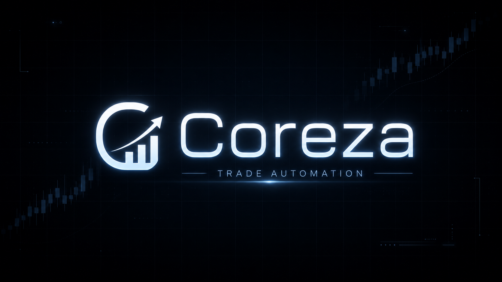

# Coreza Trading Automation Platform


[](https://github.com/Coreza-io/coreza/stargazers)
[](https://github.com/sponsors/Coreza-io)
[](https://discord.gg/SjeRSj4rJ)

An advanced, open-source trading platform that combines powerful workflow automation with institutional-level security. Built for traders, by traders - featuring multi-broker integration, real-time market data, technical analysis, and visual workflow orchestration.

## 🌟 What Makes Coreza Different

- **Visual Workflow Builder**: Design complex trading strategies without code using our intuitive node-based editor
- **Multi-Broker Support**: Trade seamlessly across Alpaca, Dhan, and more brokers from a single platform
- **Enterprise Security**: Bank-grade AES-256-GCM encryption and Row Level Security for credential management
- **Real-Time Analytics**: Live market data, technical indicators, and risk management in one unified interface
- **100% Open Source**: Fully transparent codebase under AGPL-3.0 - audit, customize, and extend freely

## 📺 Introduction Video

<a href="https://www.youtube.com/watch?v=QQSBB3aKPKM">
  
</a>

## Scheduler


## Stream


## Backtest


## 🚀 Quick Start

Get up and running in minutes with our automated setup:

```bash
# Clone the repository
git clone https://github.com/Coreza-io/coreza.git
cd coreza

# Run the automated setup
node setup/setup.js

# ⚠️ IMPORTANT: Start Redis queue+cache instances manually in separate shell(s)

# On Windows (cmd or PowerShell):
redis-server.exe --port 6379

# On Linux:
redis-server --port 6379 --daemonize yes

# On macOS:
redis-server --port 6379 --daemonize yes

# Once Redis is running, start the frontend:
npm run dev

# In another terminal, start the backend:
cd coreza-backend
npm run dev

# In a third terminal, start market stream service:
cd coreza-backend/market-stream-service
npm run dev
```

The setup script will:

- Install all dependencies (frontend & backend)
- Configure your Supabase project
- Generate secure encryption keys
- Set up environment files
- Initialize the database schema
- Validate your installation

## 🛠️ Technology Stack

### Backend

- **Runtime & framework**: Node.js 18+, Express, TypeScript 5.4
- **Execution & messaging**: BullMQ workers, ioredis, ws
- **Validation & contracts**: Zod
- **AI orchestration**: LangChain-powered agent tooling
- **Platform services**: Supabase JavaScript client

### Frontend

- **Core app**: React 18, TypeScript 5, Vite 5
- **Styling & UI system**: Tailwind CSS 3, shadcn/ui on Radix UI
- **State, routing, and async data**: Zustand, React Router, TanStack Query
- **Interaction & forms**: framer-motion, React Hook Form

### Data Visualization & Editors

- **Financial charting**: TradingView Lightweight Charts
- **Dashboard charting**: Recharts
- **Workflow editor**: xyflow / React Flow
- **Iconography**: Lucide React

### Data & Infrastructure

- **Core data platform**: Supabase (PostgreSQL, Auth, Row Level Security)
- **Queue and state transport**: Dual Redis topology (`REDIS_QUEUE_URL` for BullMQ, `REDIS_CACHE_URL` for cache/state)
- **Deployment/runtime tooling**: Docker Compose
- **Observability (optional stack)**: Prometheus + Grafana

### Security

- **Credential protection**: AES-256-GCM encryption for broker/API secrets
- **Auth/session model**: JWT auth (global token checks without per-request DB lookups)
- **Data isolation**: Supabase Row Level Security policies
- **Key handling**: User-scoped encryption keys derived in the backend from `COREZA_ENCRYPTION_KEY`

## ✨ Core Features

- **Multi-broker support** (Alpaca, Biance, more coming)
- **Real-Time Market Data & Streaming**
- **Technical indicators** (RSI, MACD, Bollinger Bands, etc.)
- **Workflow automation** Visual Workflow & Strategy Builder
- **Risk management** tools

## 💡 Why Open Source?

Coreza is built in the open to give traders and firms full control of their automation stack:

- **Transparency by default**: Inspect, audit, and verify every component of the platform
- **Security-first**: AGPL-3.0 ensures improvements to credential handling remain shared with the community
- **Community velocity**: Shared workflows, connectors, and strategies accelerate what everyone can build

## 🛠️ Manual Setup

If you prefer manual setup or the automated setup fails:

### Prerequisites

- Node.js 18+
- A Supabase account and project (required for authentication and database)
- Git

### Required Credentials (for `node setup/setup.js`)

The setup wizard requires these Supabase credentials and runtime values:

Project links use `YOUR_PROJECT_REF` as a placeholder. Replace it with your
project reference, or select your project in the Supabase dashboard.

| Variable | Where it is used | Required format / notes | Where to get it |
| --- | --- | --- | --- |
| `VITE_SUPABASE_URL` / `SUPABASE_URL` | Frontend + backend runtime | `https://<project-ref>.supabase.co` | [Project Settings → General](https://supabase.com/dashboard/project/YOUR_PROJECT_REF/settings/general): use the project reference to form the hosted project URL. |
| `VITE_SUPABASE_PROJECT_ID` / `SUPABASE_PROJECT_ID` | Frontend + backend + setup | Derived from Supabase URL project ref | [Project Settings → General](https://supabase.com/dashboard/project/YOUR_PROJECT_REF/settings/general): copy the Project ID/reference. |
| `VITE_SUPABASE_PUBLISHABLE_KEY` / `SUPABASE_PUBLISHABLE_KEY` | Frontend + backend runtime | Must start with `sb_publishable_` | [Project Settings → API Keys](https://supabase.com/dashboard/project/YOUR_PROJECT_REF/settings/api-keys): copy the Publishable key. |
| `SUPABASE_SECRET_KEY` | Backend + market-stream runtime | Secret key or legacy `service_role` key (backend-only; no prefix requirement) | [Project Settings → API Keys](https://supabase.com/dashboard/project/YOUR_PROJECT_REF/settings/api-keys): copy or create a Secret key, or copy the legacy `service_role` key. |
| `SUPABASE_ACCESS_TOKEN` | Setup-only CLI auth (`.env.setup.local`) | Must start with `sbp_` (Supabase account access token) | [Account → Access Tokens](https://supabase.com/dashboard/account/tokens): generate a personal access token and save it when displayed. |
| `SUPABASE_DB_PASSWORD` | Setup-only CLI migrations (`.env.setup.local`) | Postgres DB password required for non-interactive `supabase db push` | Use the password saved when creating the project, or reset it in [Database → Settings](https://supabase.com/dashboard/project/YOUR_PROJECT_REF/database/settings). This is not your account login password; update existing connections if you reset it. |
| `COREZA_ENCRYPTION_KEY` | Backend + market-stream runtime | Auto-generated by setup if missing | Generated locally by setup; keep the existing value on subsequent installs. |
| `REDIS_QUEUE_URL`, `REDIS_CACHE_URL` | Backend + market-stream runtime | Defaults to `redis://localhost:6379` | Your local Redis instance or your Redis provider's connection details. |

> `SUPABASE_ACCESS_TOKEN` is an **account access token**, not a publishable/anon/service-role/secret key.

## 📁 Project Structure

```
coreza/
├── src/                    # Frontend React application
├── coreza-backend/         # Backend Node.js application
├── supabase/              # Supabase configuration & migrations
├── setup/                 # Setup and validation scripts
├── docs/                  # Documentation
└── tests/                 # Test suites
```

## 📖 Documentation

- [Setup Guide](docs/SETUP.md) - Detailed setup instructions
- [Troubleshooting](docs/TROUBLESHOOTING.md) - Common issues and solutions
- [Deployment Guide](docs/DEPLOYMENT.md) - Production deployment
- [Security Guide](docs/SECURITY.md) - Security best practices
- [Self-Hosting Guide](docs/SELF_HOSTING.md) - Host Coreza yourself

## 🤝 Contributing

1. Fork the repository
2. Create your feature branch (`git checkout -b feature/amazing-feature`)
3. Commit your changes (`git commit -m 'Add amazing feature'`)
4. Push to the branch (`git push origin feature/amazing-feature`)
5. Open a Pull Request
6. Follow our [Code of Conduct](CODE_OF_CONDUCT.md) in all interactions

## License

Coreza Community Edition is open-source software licensed under the GNU Affero General Public License v3.0 only.

You may use, modify, and distribute Coreza under the terms of AGPL-3.0.

If you modify Coreza and make it available to users over a network, you must make the corresponding source code available under AGPL-3.0.

Commercial licenses may be available for companies that need private modifications, proprietary distribution, embedding, white-labeling, or enterprise use outside AGPL obligations.

See the [LICENSE](LICENSE) file for details.

## 🆘 Support

- **Documentation**: Check our comprehensive docs in `/docs`
- **Issues**: Report bugs via GitHub Issues using our templates
- **Community**: Join [GitHub Discussions](https://github.com/Coreza-io/coreza/discussions) or our community channels
- **Sponsor**: Support ongoing development via [GitHub Sponsors](https://github.com/sponsors/Coreza-io)
- **Discord**: Real-time chat for contributors and operators (community invite available)

---

**⚠️ Security Notice**: This platform handles financial data and trading credentials. Always:

- Keep your encryption keys secure
- Use HTTPS in production
- Regularly update dependencies
- Review access permissions

## ⚠️ Disclaimer

Coreza is provided for **educational and research purposes only**. It is open-source software distributed AS-IS, without warranty of any kind. Do not trade with money you cannot afford to lose. **You use Coreza entirely at your own risk**—the maintainers, contributors, and affiliates accept no responsibility for financial losses, missed trades, broker outages, data errors, or other damages resulting from its use.

Always backtest and paper-trade strategies extensively before connecting to any live brokerage account. Past performance of any strategy, indicator, or backtest output does not guarantee future returns. Trading equities, futures, options, and crypto involves substantial risk of loss and is not suitable for every investor. You are solely responsible for complying with applicable laws, tax rules, and broker terms in your jurisdiction.

Happy trading! 🚀
