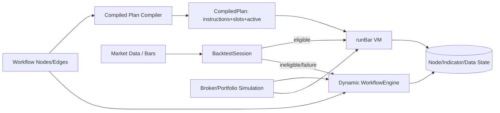

# RFC: Integrate Compiled Plan Adapters (End-to-End)

## Scope
This RFC explains the current implementation behind **"Integrate compiled plan adapters"** in `coreza-backend`, including the compile path, VM path, and fallback path.

Assumptions:
- This RFC describes the **current code behavior** and immediate architectural implications.
- Backtest mode is the primary consumer of the compiled plan path.
- Live mode still uses the dynamic engine path today.

---

## A) Coreza Mental Model (Formalized)

### Execution lifecycle

1. **Init**
   - `BacktestSession` constructs a `WorkflowEngine`, pins `BacktestInit` outputs, and attempts a one-time `compilePlan(...)`.
2. **Warmup**
   - Warmup is represented as early bar processing and/or pinned init outputs; compiled plan rehydrates pinned slots each bar.
3. **Run**
   - Per bar, session chooses either:
     - **Compiled VM path** via `runBar(plan, input)`.
     - **Dynamic engine path** via `executeFromEntries*`.
4. **Shutdown/finalize**
   - Session finalizes metrics/output, writes timing/progress, and cleans resources.

### Separation of concerns

- **Workflow definition**: `nodes[] + edges[]` are immutable strategy graph definitions.
- **Execution engine**: two runtimes now exist:
  - Dynamic graph engine (`WorkflowEngine` queue/router).
  - Compiled instruction VM (`compiledPlan`).
- **Runtime state**:
  - Node state in store (`getState/setState`) and indicator/data contexts.
  - Per-bar transient payload and activation state (`slots[]`, `active[]`) in VM.

### Coreza vs n8n / QuantConnect

- **vs n8n**: Coreza adds deterministic bar-driven execution constraints, market-time semantics, and strategy-state continuity; not generic business automations.
- **vs QuantConnect**: Coreza preserves low-code node DAG authoring while introducing compiler/VM mechanics to approach LEAN-like deterministic, efficient bar loops.

---

## B) High-Level Architecture

### Components and why they exist

- **Workflow compiler/planner (`compilePlan`)**: converts DAG + precompiled templates into dense instruction arrays and slot resolvers to eliminate per-bar routing overhead.
- **Execution engine (`WorkflowEngine`)**: compatibility runtime that supports broader node semantics and acts as fallback.
- **Backtest runner (`BacktestSession`)**: orchestrates bars, chooses compiled vs dynamic path, reports progress/finalization.
- **Live runner**: currently conceptually dynamic-first; compiled path integration is backtest-focused.
- **Market data layer**: emits bar events consumed by session.
- **Broker abstraction/state**: shared executor behavior/state accessed by node executors in either runtime.
- **State/storage layer**: node store, indicator manager, DataContext, Redis progress/timing.

Data/event flow is event-push driven: bars are pushed to entry nodes, execution propagates through graph edges (dynamic) or precomputed downstream indices/branch maps (compiled).

---

## C) Node Execution Model (Critical)

### When a node executes

- **Compiled path**: node executes when its instruction index is marked active in the VM scan.
- **Dynamic path**: node executes when queue/router dependency satisfaction and routing logic enqueue it.

### Node input context

Compiled adapter signature:
- `(node, input, resolvedParams, ctx) => NodeResult`.
- `ctx.resolveNodeParameters` is overridden to return pre-resolved params.
- `ctx.nodeId` is updated per instruction.

VM currently passes `slots[inputSlot]` as the `input` argument to every instruction in that bar, while parameter resolution pulls inter-node dependencies from slots.

### Node output

- `NodeResult` normalized by adapter and written to instruction `outSlot`.
- Downstream activation:
  - `EXEC`: activate all downstream indices.
  - `BRANCH`: activate targets selected via result-derived branch handles.

### Backtest vs live differences

| Aspect | Backtest (compiled eligible) | Backtest/live (dynamic) |
|---|---|---|
| Dispatch | Linear instruction scan | Queue + router + dependency checks |
| Parameter resolution | slot-based precompiled | runtime resolve + precompiled helper |
| Branching | branchMap in instruction | router edge-handle logic |
| Fallback behavior | immediate to dynamic engine | native |

### Stateless vs stateful nodes

- **Stateless**: pure transformations; ideal for compiled deterministic execution.
- **Stateful**: use `ctx.getState/setState` and indicator/data context; compiled path preserves access through context bridges.

### Determinism and side effects

- Determinism is improved via fixed topological instruction order and per-bar reset of activation array.
- Side effects are still executor-defined; compiler gates out unsupported node classes (`Loop`, `LLM`, `AIAgent`) to reduce semantic divergence.

---

## D) Scheduler & Time Control

### Current scheduler gating model in this integration

- Scheduler remains an executable node category (`Utility`) and is not a separate global clock gate in compiled VM.
- Bars are still the external heartbeat from `BacktestSession`.
- Compiled VM simply executes active instructions; schedule semantics rely on scheduler node executor outputs and downstream branch/control wiring.

### Warm-up and non-met schedules

- Warm-up-compatible behavior today is primarily achieved through pinned init outputs + normal bar progression.
- If schedule condition is false, downstream activation should be prevented by scheduler/control-flow node output semantics.

### Missed/delayed bars

- Backtest is deterministic iteration; no “missed bars” concept.
- Live missed/delayed bars handling is not part of this compiled integration and remains a live-runner concern.

---

## E) Data & State Management

- **Historical bars**: provided as `bars[]` to session.
- **In-memory state**:
  - VM: `slots[]` + `active[]`.
  - Engine: queue, edge payloads, node results.
- **Persistent-ish execution state**:
  - NodeStore via `storeGetState/storeSetState` bridged into compiled context.
  - IndicatorStateManager + DataContext shared.
- **Portfolio/trade state**: managed in executor/domain layers; this integration focuses on orchestration runtime.

### Isolation/recovery/deterministic replay

- Backtest isolation: per-run session state and context keyed by run/workflow/user IDs.
- Crash recovery for live is not implemented by this change.
- Deterministic replay gains in compiled path come from static topo order + explicit slot rewiring with fallback on unsupported templates.

---

## F) Backtesting Engine Design (as integrated)

### Deterministic bar loop

`BacktestSession.runAll()` iterates bars in chunks, invoking either:
- `runBar(compiledPlan, {data: currentEvent})`, or
- dynamic engine execution methods.

### Scheduler/loop interaction

- Bar loop is outer driver.
- Scheduler/control nodes run inside graph execution and gate propagation through outputs/branches.

### Signal propagation

- Compiled: `active[]` marks instruction fire eligibility; propagation via downstream arrays/branch maps.
- Dynamic: router determines next nodes and queue behavior.

### Performance metrics computation

- Session tracks progress and finalizes through `BacktestExecutor.finalizeBacktestById(...)`.
- Timing is captured via engine timing APIs and persisted to Redis.

---

## G) Live Trading Engine Implications

This integration does **not** yet wire compiled plan adapters into live execution loops.

Recommended live design alignment:
- Keep same compiler artifact and VM instruction semantics for parity.
- Add reconciliation checkpoints between VM-visible state and broker truth.
- Add idempotent order intents keyed by deterministic event IDs.
- Use retry policies with bounded backoff + dead-letter diagnostics.
- Fail-safe actions: pause strategy, flatten positions, or safe-degrade to dynamic engine mode.

---

## H) Trade-offs and Explicit Decisions

### Optimized for
- **Determinism**: topo order, dense slots, explicit branch maps.
- **Extensibility**: adapter layer wraps existing `executeSync` executors (minimal executor rewrites).
- **Performance clarity**: no hidden queue/dependency work in hot loop.

### Intentionally avoided
- Hidden magic around unsupported template/node patterns.
- Implicit runtime reinterpretation when compile eligibility is uncertain.

### Simplicity over peak performance
- Single-threaded linear scan VM (simple and predictable) over speculative parallel node execution.
- Fallback-to-dynamic for unsupported cases instead of partially compiling ambiguous graphs.

---

## I) Evolution Roadmap

### v1 (current direction)
- Single-process compiled backtest VM.
- Single broker simulation path.
- Eligibility gating + deterministic fallback.

### v2
- Distributed backtest workers and plan artifact distribution.
- Redis streams/event-bus for bar/event fan-out.
- Shared compiled-plan cache keyed by workflow hash.

### v3
- Multi-tenant scheduler/runtime partitions.
- Live compiled execution parity with reconciliation journaling.
- Optional HFT-oriented micro-batching and symbol-sharded execution lanes.

---

## Implementation Notes for Reviewers

1. Keep adapter `CATEGORY_MAP` in lockstep with `WorkflowEngine` category resolution.
2. Consider pre-binding per-node `execFn` once (already done) and preallocating branch handle arrays.
3. Consider passing node-specific input slots in future revision if executor contracts require upstream-specific payloads.
4. Add golden parity tests: same graph + bars should match outputs between VM and dynamic engine.
