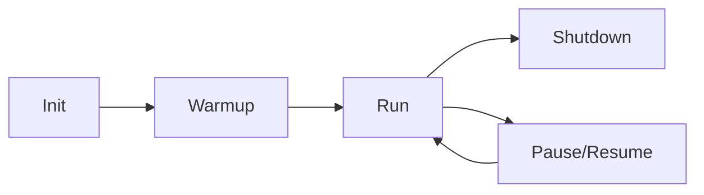
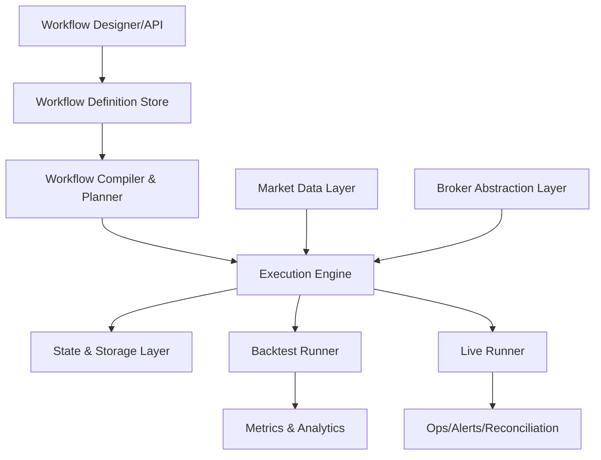
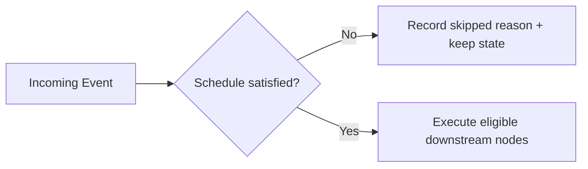
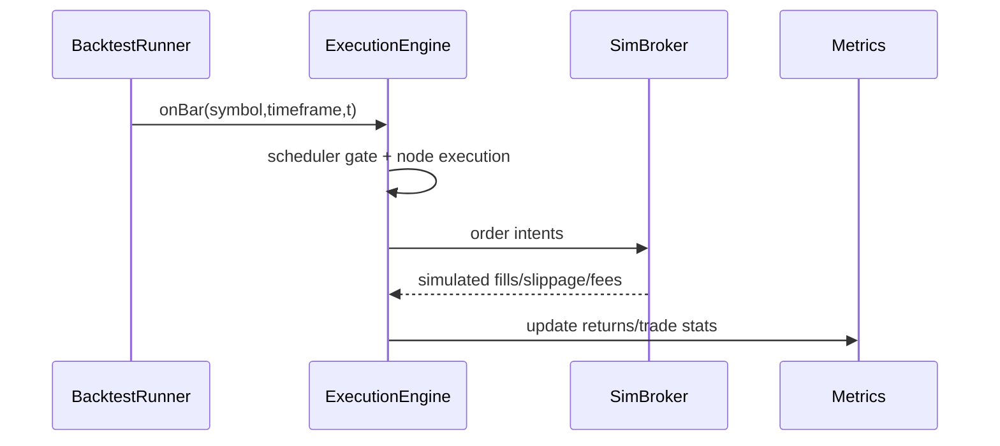

# Coreza Trading OS — Architecture RFC

**Status:** Draft for implementation alignment  
**Audience:** Workflow engine, quant infra, execution, and platform engineers  
**Scope:** Unified workflow + trading runtime for backtest/live parity

---

## Assumptions

1. A workflow is represented as a versioned DAG (`nodes`, `edges`) plus metadata.
2. Backtests run against immutable historical datasets (bars/corporate actions/calendar snapshots).
3. Live mode receives event streams that may be delayed, duplicated, or reordered.
4. Coreza must preserve strategy semantics between modes; only data source and side-effect adapters differ.
5. Exchange calendars, symbol mappings, and corporate actions are normalized upstream by the market data layer.

---

## A) Coreza Mental Model

### 1) Execution lifecycle

- **Init**
  - Load workflow definition by version.
  - Compile workflow into executable plan (topology, parameter templates, node executors).
  - Create run-scoped runtime state (portfolio, indicators, node memories, scheduler state).
- **Warmup**
  - Feed required historical bars for indicators/stateful nodes.
  - Scheduler may advance internal clock but should not emit tradable actions unless explicitly configured.
- **Run**
  - Process external events (`bar`, `schedule`, `order_fill`, `risk_alert`, `control`).
  - Route events through scheduler gate, then execute eligible nodes.
  - Persist checkpoints and outputs.
- **Shutdown**
  - Flush state snapshots, pending metrics, execution logs.
  - Cancel subscriptions, close broker adapters, mark run terminal status.

### 2) Separation of concerns

| Layer | Owns | Does not own |
|---|---|---|
| **Workflow Definition** | User-authored DAG, node configs, wiring | Runtime memory, broker state |
| **Execution Engine** | Scheduling, dispatch, dependency resolution, retries/idempotency | Historical storage internals |
| **Runtime State** | Node state, indicator caches, portfolio/orders, checkpoints | Workflow editing/planning |

### 3) How Coreza differs

| System | Primary abstraction | Limitation Coreza addresses |
|---|---|---|
| **n8n** | Business workflow automation | Lacks market-time determinism, portfolio/order simulation, bar-driven semantics |
| **QuantConnect Lean** | Code-first algorithm engine | Lacks visual DAG composition and node-level orchestration model |
| **Coreza** | Visual strategy DAG + deterministic trading runtime | Unifies designer ergonomics with quant-grade execution parity |

---

## B) High-Level Architecture

### Components and purpose

1. **Workflow Compiler / Planner**
   - Validates DAG (acyclic constraints where required, loop semantics where allowed).
   - Precomputes graph indices, dependency maps, execution categories, parameter templates.
   - Outputs immutable `ExecutionPlan` with plan hash.
2. **Execution Engine**
   - Event-driven orchestrator for queueing and node dispatch.
   - Owns scheduler gating, dependency checks, and side-effect isolation boundaries.
3. **Backtest Runner**
   - Drives deterministic bar iteration over historical timeline.
   - Injects simulated fills/slippage/fees and produces metrics.
4. **Live Runner**
   - Consumes realtime feeds and broker events.
   - Handles outages, retries, reconciliation, and operational controls.
5. **Market Data Layer**
   - Unified API for historical + live bars/ticks/calendar/corporate actions.
   - Ensures symbol canonicalization and session clocks.
6. **Broker Abstraction Layer**
   - Normalized order lifecycle API (`submit`, `cancel`, `replace`, `query`, `sync`).
   - Adapter-specific behavior hidden behind deterministic interface.
7. **State & Storage Layer**
   - Checkpointing, event log, run artifacts, portfolio snapshots, indicator state.
   - Supports replay and crash recovery.

### Event/data flow

1. Runner emits canonical event.
2. Execution engine applies scheduler gates + dependency checks.
3. Eligible node executes with run context snapshot.
4. Node result routes through edges; side effects emitted to outbox.
5. Outbox commits to broker/data/storage adapters with idempotency keys.
6. State checkpoints and metrics updated.

---

## C) Node Execution Model (Critical)

### Node contract

- **Execute when**
  - All required upstream dependencies are satisfied for that trigger window.
  - Scheduler gate allows the node at engine time `t`.
- **Input context**
  - `event`: canonical trigger payload (`bar`, `fill`, `timer`, etc.).
  - `market`: symbol/timeframe slice(s), calendar/session metadata.
  - `state`: node-local + run-shared readonly snapshot.
  - `portfolio`: positions, cash, equity, open orders.
  - `mode`: `isBacktest` boolean, run identifiers, deterministic seed.
- **Output**
  - `data`: typed payload for downstream nodes.
  - `signals`: optional intents (entry/exit/size/risk flags).
  - `effects`: side-effect intents (order submit, notification, storage write).
  - `telemetry`: timing, counters, diagnostic tags.

### Stateless vs stateful

| Node type | Persistence | Example |
|---|---|---|
| **Stateless** | No internal memory between executions | pure transform/condition |
| **Stateful** | Deterministic state evolution persisted in checkpoint | indicator windows, loop counters, rolling risk stats |

### Backtest vs Live semantics

| Aspect | Backtest | Live |
|---|---|---|
| Event source | Historical iterator | Streaming feed + broker callbacks |
| Clock | Deterministic simulated clock | Wall-clock + exchange session clock |
| Side effects | Simulated broker/storage | Real adapters with retries and reconciliation |
| Ordering | Fully deterministic | Best-effort ordered, corrected via sequence+reconcile |

### Determinism and side effects

- Strategy nodes must be deterministic as a function of `(plan_hash, input_event_stream, seed, config_snapshot)`.
- External side effects are **intent-based** via outbox; execution result is persisted before adapter dispatch.
- Broker/network calls must not occur directly inside strategy computation nodes.

---

## D) Scheduler & Time Control

### Scheduler modes

1. **Cron-based schedule nodes**
   - Exchange-aware cron (e.g., `0 9 * * MON-FRI` in market timezone).
2. **Bar-index scheduling**
   - Fire every `N` bars, or at bar offsets from session open/close.
3. **Session-aware scheduling**
   - Guards for premarket/regular/postmarket and holidays.

### Gating behavior

- If NOT met: event may still update warmup/internal caches but no tradable side effects propagate.
- Missed/delayed bars:
  - Backtest: impossible by construction (strict iterator).
  - Live: engine tags late events; policy selectable per workflow:
    1) process-late-in-order, 2) skip-late, 3) coalesce-late-by-bar.

### Warmup handling

- Warmup bars advance indicator/state nodes.
- Scheduler can run in `warmup=true` mode where order-producing nodes are suppressed unless explicitly allowed for paper calibration workflows.

---

## E) Data & State Management

### State domains

1. **Market data store**
   - Historical OHLCV, optional ticks, corporate actions, session calendar snapshots.
2. **Run state (in-memory hot path)**
   - Current bar context, dependency counters, queue, fast indicator buffers.
3. **Persistent checkpoint state**
   - Node state blobs, portfolio/open orders, scheduler cursors, last processed offsets.
4. **Artifact store**
   - Metrics, fills ledger, diagnostics, replay traces.

### Required guarantees

- **Backtest isolation**: each run has dedicated namespace; no shared mutable strategy state.
- **Crash recovery (live)**:
  - Restore latest durable checkpoint.
  - Reconcile with broker open orders/positions.
  - Resume from last acknowledged market-data offset.
- **Deterministic replay**:
  - Persist canonical event log + plan hash + config snapshot.
  - Re-execution over same inputs must match node outputs and portfolio curve.

---

## F) Backtesting Engine Design

### Deterministic loop

### Multi-symbol support

- Global engine clock advances by merged sorted event stream across symbols/timeframes.
- Each bar event carries `(symbol, timeframe, timestamp, sequence)`.
- Strategy nodes may consume single-symbol or basket context with deterministic symbol ordering.

### Metrics computation

- Collect run-level and strategy-level metrics incrementally:
  - CAGR, Sharpe/Sortino, max drawdown, win rate, profit factor, exposure, turnover.
- Use portfolio equity time series sampled at configured interval.
- Record trade ledger for attribution (entry/exit, MAE/MFE, slippage impact).

### Signal propagation

1. Indicator/signal nodes emit normalized intents.
2. Risk/portfolio nodes transform intents into order proposals.
3. Execution nodes submit intents to simulated broker.
4. Fill events re-enter engine as first-class events.

---

## G) Live Trading Engine Design

### Core responsibilities

- Subscribe to realtime market streams with heartbeat monitoring.
- Maintain broker sync loop for orders/positions/cash.
- Expose operator controls: pause, resume, flatten/liquidate, safe-stop.

### Reconciliation strategy

1. On startup/resume, query broker truth snapshot.
2. Compare against local checkpoint (`positions`, `open orders`, `cash`).
3. Resolve drift via policy:
   - adopt-broker-truth for balances/positions,
   - reconcile-order-state by broker order IDs,
   - generate synthetic correction events into engine.

### Idempotency and retries

- Every side-effect intent has deterministic idempotency key (`runId/nodeId/eventSeq/effectIdx`).
- Adapter retries are exponential with jitter and terminal classification.
- Duplicate broker callbacks are deduped by `(brokerOrderId, eventType, brokerEventSeq)`.

### Fail-safe behavior

- Data feed outage: halt order-producing nodes, keep health alerts active.
- Broker API outage: queue non-expired intents, enforce risk throttles, optional emergency flatten via backup route.
- Prolonged inconsistency: switch workflow to `SAFE_MODE` (read-only strategy evaluation, no new entries).

---

## H) Trade-offs & Explicit Decisions

### What Coreza optimizes for

1. **Determinism first** (especially backtests and replayability).
2. **Clarity of execution semantics** (explicit scheduler gates and event contracts).
3. **Extensibility** via node/executor abstraction and pluggable adapters.

### What Coreza avoids

- Hidden timing behavior (implicit polling / implicit clocks).
- Direct side effects inside arbitrary nodes.
- Mode-specific strategy code paths where avoidable.

### Simplicity over peak performance

- Prefer explicit event logs + checkpoints over opaque in-memory shortcuts.
- Prefer predictable single-process runner in v1 before distributed fan-out.
- Accept modest overhead for strong observability and reproducibility.

---

## I) Evolution Roadmap

### v1 — Single-runner foundation

- Single process execution runtime.
- Single broker adapter (e.g., Alpaca) + simulated broker.
- Deterministic backtesting with bar-level events.
- Basic scheduler, checkpoints, reconciliation, and core metrics.

### v2 — Distributed reliability

- Worker pool for node execution with Redis Streams/Kafka outbox.
- Partitioning by run/workflow with sticky state ownership.
- Advanced retries, dead-letter queues, and cross-worker idempotency.
- Multi-broker adapters and richer risk controls.

### v3 — Multi-tenant + higher frequency

- Tenant isolation with resource quotas and admission control.
- Tick/intraday high-throughput path with bounded-latency scheduler.
- Stateful stream processing primitives for micro-batch/tick aggregation.
- Enterprise-grade governance (audit, lineage, policy engine).

---

## Implementation Notes Aligned to Current Refactor

- Keep `WorkflowEngine` as orchestration shell only.
- Preserve runtime polymorphism (`StandardExecutionRuntime` vs `BacktestExecutionRuntime`) to avoid branch-heavy mode checks.
- Use `isBacktest` naming consistently in context payloads and compiler/runtime interfaces.
- Ensure planner output is immutable and hashable to support deterministic replay contracts.
