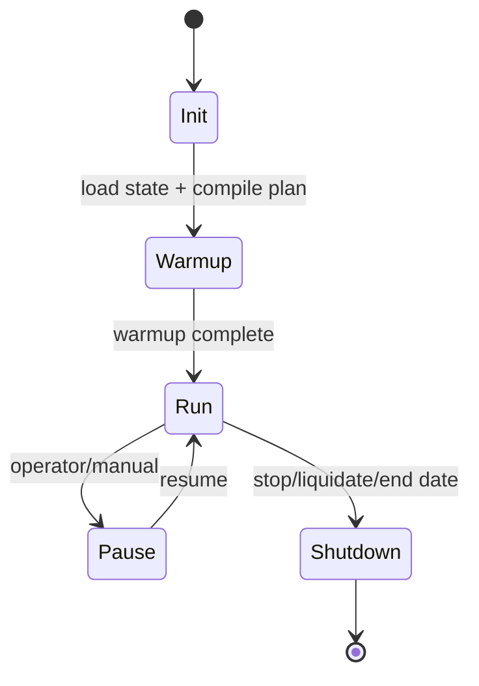
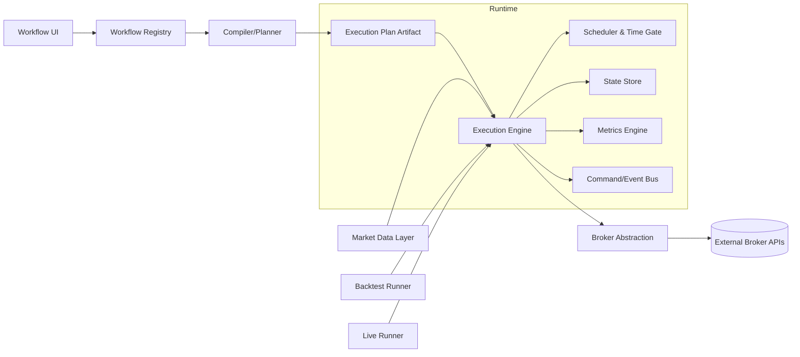
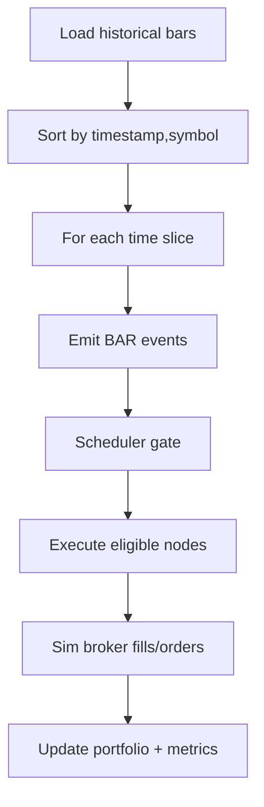

# Coreza Architecture RFC: Workflow-Native Trading OS

**Status:** Draft v1  
**Audience:** Quant engineering, platform engineering, runtime team  
**Date:** 2026-04-07

---

## Assumptions

1. Coreza workflows are directed acyclic graphs (DAGs) at compile time; loops are modeled via scheduler/event recurrence, not graph cycles.
2. Engine processes market events in a single deterministic event stream per strategy run for v1.
3. Bar is the canonical clock for trading logic; tick-level support is deferred.
4. Every execution run has a unique `executionId` used as the primary state namespace.
5. Backtest and live share the same node contracts and execution planner.

---

## A) Coreza Mental Model & Execution Lifecycle

Coreza has three independent layers:

| Layer | What it is | Immutable? |
|---|---|---|
| Workflow Definition | User-authored graph (`nodes`, `edges`, params) | Yes (versioned) |
| Execution Plan | Compiled graph with node order, trigger/gate metadata | Yes per workflow version |
| Runtime State | Indicator buffers, portfolio, broker/order state, caches | No (changes every event) |

### Lifecycle



#### `Init`
- Load workflow definition by version.
- Compile to execution plan.
- Bind market data + broker adapters.
- Allocate runtime namespaces by `executionId`.

#### `Warmup`
- Replay historical bars to prime indicators and rolling windows.
- Scheduler receives bars but strategy side effects are gated.
- Portfolio/order nodes are in **read-only/simulation disabled** mode.

#### `Run`
- Event loop consumes canonical events (`BAR`, `SCHEDULE`, `ORDER_FILL`, `RISK_ALERT`, etc.).
- Scheduler gates strategy execution windows.
- Execution nodes emit side effects through idempotent command bus.

#### `Shutdown`
- Flush checkpoints.
- Optionally liquidate positions via policy.
- Persist final metrics, fills, and state snapshots.

### How Coreza differs

| System | Primary abstraction | Limitation | Coreza stance |
|---|---|---|---|
| n8n | Generic business workflow automation | Time/data semantics not trading-native | Coreza is event-time and market-session native |
| QuantConnect | Code-first algorithm class | Less visual composition, harder modular reuse | Coreza keeps quant semantics but node-native composition |

---

## B) High-Level Architecture



### Components and why they exist

1. **Workflow Compiler / Planner**
   - Validates DAG, node typing, data contracts.
   - Produces deterministic execution order and trigger map.
   - Prevents runtime ambiguity and hidden ordering bugs.

2. **Execution Engine**
   - Core event dispatcher.
   - Executes nodes by plan + scheduler gate.
   - Maintains deterministic sequencing.

3. **Backtest Runner**
   - Feeds historical bars deterministically.
   - Controls virtual clock and reproducible random seeds.

4. **Live Runner**
   - Subscribes to real-time feeds and broker events.
   - Handles reconnect/reconcile and runtime control operations.

5. **Market Data Layer**
   - Unified bars API for historical + stream.
   - Normalizes symbol calendars, splits, dividends.

6. **Broker Abstraction Layer**
   - Normalized order lifecycle and fill model.
   - Supports simulator broker + real brokers behind same contract.

7. **State & Storage Layer**
   - Ephemeral in-memory hot state.
   - Durable checkpoints, orders/fills, metrics, run logs.

---

## C) Node Execution Model (Critical)

### Node contract

**Input context** (minimum):
- `executionId`, `workflowId`, `mode(backtest|live)`, `event`, `clock`, `symbolScope`
- `stateReaders/writers`
- `services` (data, broker, storage)

**Output envelope**:
- `data` (typed payload)
- `commands` (e.g., submit order)
- `events` (engine-internal)
- `stateDelta` (explicit state mutation)
- `diagnostics` (latency, warnings)

### When node executes

A node executes iff all are true:
1. Upstream dependencies for current event are satisfied.
2. Scheduler gate permits execution at event-time.
3. Node-specific preconditions pass (warmup complete, position exists, etc.).

### Stateless vs stateful

| Type | Examples | Persistence |
|---|---|---|
| Stateless | Math transform, condition, formatter | None |
| Stateful | Indicators, Portfolio, Risk, Broker proxy | Namespaced by `executionId` and nodeId |

### Backtest vs live behavior

| Concern | Backtest | Live |
|---|---|---|
| Clock | Virtual deterministic | Wall-clock + exchange session |
| Data arrival | Ordered replay | Potential jitter/out-of-order (must normalize) |
| Side effects | Simulated broker only | Real broker with idempotent commands |
| Retry semantics | Usually unnecessary | Required (network/broker faults) |

### Side-effect isolation

- Strategy nodes are pure or bounded-state only.
- Execution nodes emit **commands**, not direct side effects.
- Command bus applies idempotency key: `executionId + nodeId + eventId + intentHash`.

---

## D) Scheduler & Time Control

Scheduler supports:
1. **Cron schedule nodes** (e.g., every weekday 09:35 ET)
2. **Bar-index scheduling** (every N bars, first bar after open)
3. **Market-session awareness** (RTH/ETH calendars, holidays, half-days)
4. **Warm-up handling** (allow state updates, block trading side effects)

### Gating semantics

```text
if scheduler.allows(eventTime, nodeSchedule, sessionState) == false:
    mark node as SKIPPED_BY_SCHEDULE
    propagate no-op token downstream (where required)
```

### Missed/delayed bars

- **Backtest:** impossible by definition if data source is complete; gaps are explicit data gaps.
- **Live:** use watermark window:
  - late but within tolerance: reorder and process.
  - beyond tolerance: mark dropped, emit `DATA_GAP` event.
- Scheduler never retroactively fires closed windows unless node explicitly opts into catch-up mode.

---

## E) Data & State Management

### Storage model

| Data class | Hot path | Durable store |
|---|---|---|
| Bars | in-memory ring buffers | columnar historical store |
| Indicator state | in-memory + periodic checkpoint | key-value snapshot store |
| Portfolio/orders | in-memory authoritative runtime | append-only ledger + snapshots |
| Metrics | incremental accumulators | time-series metrics store |

### Isolation and recovery

- **Backtest isolation:** each run gets isolated namespace keyed by `executionId`; no shared mutable state.
- **Live recovery:** periodic checkpoints + broker reconciliation on restart.
- **Deterministic replay:** persist event log (`eventId`, timestamp, payload hash, decision hash).

### Indicator caching

- Cache key: `executionId/nodeId/symbol/timeframe/paramsHash`.
- Never share indicator instances across executions.

---

## F) Backtesting Engine Design

### Deterministic bar loop



### Multi-symbol strategy handling

- Use time-slice batches (all symbols for same bar time).
- Node can run in symbol-scoped or portfolio-scoped mode.
- Portfolio/risk nodes consume merged view at bar boundary.

### Metrics pipeline

Compute incrementally per bar/fill:
- equity curve
- returns series
- Sharpe/Sortino
- max drawdown + duration
- win rate, expectancy, turnover, exposure

All metrics derived from immutable ledger events to guarantee reproducibility.

---

## G) Live Trading Engine Design

### Responsibilities

1. Stream subscriptions (market data + broker order/fill streams)
2. Runtime control (pause/resume/liquidate)
3. Fault handling (network partition, broker outage)
4. Continuous reconciliation

### Reconciliation strategy

- On startup/reconnect:
  1. Pull broker positions/open orders.
  2. Compare with internal ledger snapshot.
  3. Generate reconciliation actions (`ADOPT`, `CANCEL`, `HEDGE`, `ALERT`).

### Idempotency and retries

- Every outbound order command has stable `clientOrderId` derived from idempotency key.
- Retries use exponential backoff with jitter.
- Duplicate acknowledgments collapse into same state transition.

### Fail-safe behavior

- Policy-driven: `FAIL_OPEN` (continue with caution) vs `FAIL_SAFE` (flatten and halt).
- Default for retail live trading: `FAIL_SAFE` on unrecoverable broker desync.

---

## H) Trade-offs & Explicit Decisions

### Core optimization goals

1. **Determinism first** (especially backtests)
2. **Parity first** (same workflow, same node contracts)
3. **Operational clarity** (explicit schedules, explicit state)
4. **Extensibility** (adapters, node plugins)

### Intentionally avoided

- Hidden auto-scheduling (“run whenever data arrives” magic)
- Implicit shared state across runs
- Broker-specific behavior leaking into strategy nodes

### Simplicity over raw performance (v1)

- Single-process event loop instead of distributed DAG executor.
- Coarser bar granularity before tick/HFT support.
- Strong ordering guarantees over maximal throughput.

---

## I) Evolution Roadmap

### v1 — Foundation
- Single execution worker per run
- Single simulated broker + one live broker adapter
- Deterministic backtests, explicit scheduler gating
- `executionId`-scoped state for all stateful nodes

### v2 — Scale-out runtime
- Distributed workers
- Redis streams / durable queue for event transport
- Partition by workflow run / symbol group
- Horizontal replay and metrics aggregation

### v3 — Multi-tenant + advanced execution
- Tenant-level quotas/isolation and governance
- Multi-broker smart routing
- Tick/event micro-batching for higher-frequency strategies
- Advanced risk daemon (cross-strategy exposure)

---

## Practical Guardrails for Current Implementation

1. Every execution route must map `workflowSessionId -> executionId` before invoking executors.
2. Stateful node services (`PortfolioManager`, indicator registries, order routers) must key by `executionId`, never raw `workflowId`.
3. Context schema should enforce `executionId` as required at compile/runtime boundaries.
4. Add invariant tests: two manual runs with same workflow ID but different `workflowSessionId` must produce isolated state.

These guardrails directly preserve session-scoped reset behavior and backtest/live parity expectations.
