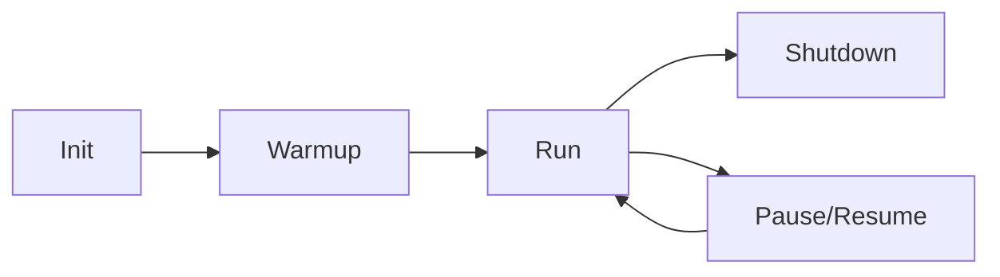
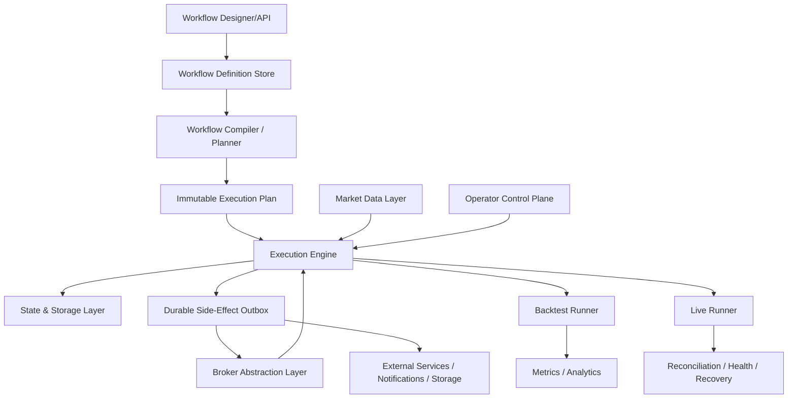
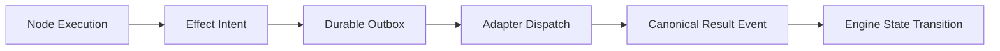
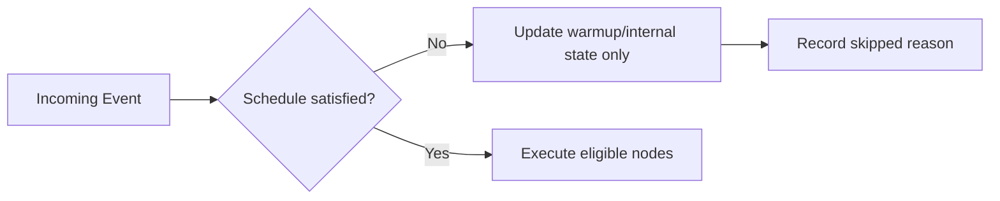
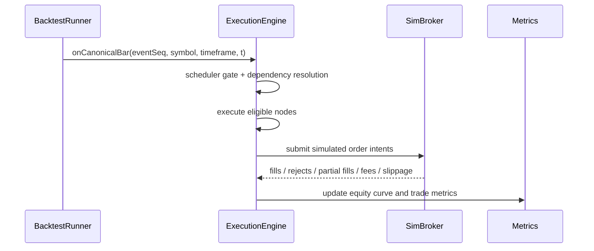

# Coreza Trading OS — Architecture RFC

**Status:** Draft for implementation alignment  
**Audience:** Workflow engine, quant infra, execution, and platform engineers  
**Scope:** Unified workflow + trading runtime for backtest/live parity and module-boundary cleanup

---

## Assumptions

1. A workflow is represented as a versioned DAG (`nodes`, `edges`) plus metadata.
2. Backtests run against immutable historical datasets (bars/corporate actions/calendar snapshots).
3. Live mode receives event streams that may be delayed, duplicated, or reordered.
4. Coreza must preserve strategy semantics between modes; only data source and side-effect adapters differ.
5. Exchange calendars, symbol mappings, and corporate actions are normalized upstream by the market data layer.
6. Strategy execution is bar/event driven; nodes do not independently poll market data.
7. The current backend already contains distinct concerns in `src/services/`, but the folder layout obscures those boundaries.

---

## A) Coreza Mental Model

### 1) Execution lifecycle



| Phase | Responsibilities | Hard rules |
|---|---|---|
| **Init** | Load workflow version, compile plan, allocate run-scoped state, bind adapters | No strategy logic executes yet |
| **Warmup** | Replay pre-run bars into indicator/state nodes, seed scheduler/session state | No externally visible trading side effects unless explicitly marked as calibration-only |
| **Run** | Consume canonical events, gate through scheduler, execute eligible nodes, emit side-effect intents | Every action must be attributable to a specific event sequence |
| **Shutdown** | Flush checkpoints, finalize metrics, unsubscribe feeds, drain outbox | Run ends in a durable terminal state |

### 2) Separation of concerns

| Layer | Owns | Does not own |
|---|---|---|
| **Workflow Definition** | User-authored DAG, node configs, edges, metadata | Runtime memory, order books, checkpoint data |
| **Execution Engine** | Scheduling, event dispatch, dependency resolution, node execution, outbox production | Workflow editing concerns, raw external APIs |
| **Runtime State** | Node-local state, indicator caches, portfolio/orders, scheduler cursors, replay offsets | Workflow authoring, long-term product configuration |

### 3) Coreza vs n8n vs QuantConnect

| System | Primary abstraction | Strength | Limitation relative to Coreza |
|---|---|---|---|
| **n8n** | Business workflow automation graph | Flexible visual orchestration | Not built for exchange calendars, deterministic bar replay, portfolio simulation |
| **QuantConnect Lean** | Code-first algorithm runtime | Excellent quantitative execution model | No first-class visual DAG, node-level orchestration, or workflow composition UX |
| **Coreza** | Trading operating system built around visual strategy DAGs | Same workflow definition drives backtest and live modes | Must be stricter than general workflow tools about timing, determinism, and side effects |

### 4) Opinionated mental model

Coreza is **not** “a web app with some trading features.” It is a **trading OS** with a workflow interface.

- The workflow DAG is the user-facing program.
- The execution engine is the kernel.
- Market data, brokers, storage, and notifications are device drivers/adapters.
- Backtest and live are two runtime modes over the same compiled plan.

That framing matters because it pushes the design toward explicit event sequencing, durable state, and recoverable side effects rather than request/response service thinking.

---

## B) High-Level Architecture



### Component roles

#### 1) Workflow Compiler / Planner
Exists to convert a user-authored DAG into an executable artifact with stable semantics.

It should:
- validate node types, parameter schemas, edge compatibility, and scheduling constraints;
- resolve node executors and parameter templates ahead of runtime;
- compute a deterministic topological and trigger-aware execution plan;
- emit an immutable `planHash` for replay, audit, and cache identity.

#### 2) Execution Engine
Exists to apply the plan to an ordered event stream.

It should own:
- event ingress;
- scheduler gating;
- dependency tracking;
- node execution dispatch;
- state transitions;
- side-effect intent creation.

It should **not** directly embed broker-specific or data-vendor-specific logic.

#### 3) Backtest Runner
Exists to create a fully deterministic simulated market/broker environment.

It should:
- iterate canonical bar streams;
- inject fills, fees, slippage, and session events;
- produce portfolio/equity metrics;
- guarantee identical outputs for identical inputs.

#### 4) Live Runner
Exists to host long-lived real trading sessions.

It should:
- subscribe to streaming market events;
- reconcile broker truth against local truth;
- recover after process restarts;
- expose safe operational controls: pause, resume, flatten, liquidate.

#### 5) Market Data Layer
Exists to normalize data sources so strategies consume a consistent event contract.

It should provide:
- historical bars for backtests and warmups;
- live bars/ticks/trades/quotes;
- exchange calendars/session metadata;
- symbol normalization and corporate action handling.

#### 6) Broker Abstraction Layer
Exists to prevent strategy code from depending on broker quirks.

It should normalize:
- order intents and acknowledgements;
- fill events;
- account/position snapshots;
- reconciliation and replace/cancel semantics.

#### 7) State & Storage Layer
Exists so runs can be paused, replayed, recovered, and audited.

It should store:
- checkpoint state;
- event logs;
- portfolio snapshots;
- metrics and artifacts;
- outbox/inbox offsets for exactly-once-ish operational behavior.

### End-to-end event flow

1. Runner emits a canonical event (`bar`, `schedule`, `fill`, `control`, `risk_alert`).
2. Engine binds the event to a run, workflow plan, and scheduler cursor.
3. Scheduler determines whether downstream strategy nodes are eligible.
4. Eligible nodes execute against a read-only context snapshot plus node-local state.
5. Node outputs become downstream payloads and/or side-effect intents.
6. Side-effect intents are persisted into a durable outbox before adapter dispatch.
7. Adapter responses re-enter the engine as canonical events.
8. Checkpoints and metrics advance only after state transition durability is satisfied.

---

## C) Node Execution Model (Critical)

### 1) When a node executes

A node executes only when **all** of the following are true:

1. A canonical event has arrived that matches the node’s trigger class.
2. Required upstream dependencies for that event window are satisfied.
3. The scheduler permits execution at the current engine time.
4. Any node-specific guards (warmup complete, symbol scope available, risk state valid) pass.

This means Coreza nodes are **push-driven**, not pull-driven.

### 2) Node input contract

Every node should receive a context shaped roughly like this:

```ts
interface NodeExecutionContext {
  run: {
    runId: string;
    workflowId: string;
    planHash: string;
    mode: 'backtest' | 'live';
    eventSeq: number;
    deterministicSeed?: string;
  };
  event: CanonicalEvent;
  clock: {
    engineTime: string;
    session: SessionInfo;
    isWarmup: boolean;
  };
  market: {
    symbol?: string;
    timeframe?: string;
    bars?: BarSlice;
    references?: Record<string, unknown>;
  };
  portfolio: PortfolioSnapshot;
  state: {
    nodeLocal: unknown;
    shared: SharedRunStateView;
  };
  services: {
    outbox: SideEffectCollector;
    logger: Logger;
    metrics: MetricsSink;
  };
}
```

Key rule: the node receives **context**, not ambient global state.

### 3) Node output contract

Each node returns one or more of the following:

| Output channel | Meaning |
|---|---|
| `data` | Structured payload for downstream graph edges |
| `signals` | Trading intent candidates, such as enter/exit/adjust |
| `effects` | Side-effect intents such as place order, notify, store artifact |
| `statePatch` | Deterministic mutation to node-local persistent state |
| `telemetry` | Timing, counters, diagnostic details |

### 4) Stateless vs stateful nodes

| Type | Characteristics | Examples |
|---|---|---|
| **Stateless node** | Pure function over current event + inputs | comparator, compute transforms, simple routing |
| **Stateful deterministic node** | Maintains replayable state scoped to run or symbol | indicators, rolling windows, portfolio simulators |
| **Side-effect node** | Produces intents but does not directly mutate external world | order submitter, webhook notifier, storage writer |

### 5) Backtest vs live differences

| Concern | Backtest | Live |
|---|---|---|
| Event source | Immutable historical iterator | Real-time stream plus broker callbacks |
| Clock | Simulated and monotonic | Real wall-clock plus exchange/session clock |
| Node state evolution | Fully reproducible | Durable and recoverable, but may require reconciliation |
| Side effects | Simulated adapters | Real adapters with retries/idempotency |
| Ordering | Strict deterministic order | Potentially late, duplicated, or out of order |

### 6) Determinism requirements

For backtesting, node execution must be a pure function of:

- plan hash;
- workflow config snapshot;
- canonical event sequence;
- deterministic seed;
- prior durable state.

That forbids:
- hidden wall-clock reads inside strategy nodes;
- random number usage without seeded injection;
- direct network access from compute nodes;
- implicit dependency on mutable global singletons.

### 7) Side-effect isolation

All side effects should be handled as **intents**:



This is the cleanest way to preserve parity:
- backtest swaps in simulated adapters;
- live uses real adapters;
- strategy nodes remain identical.

---

## D) Scheduler & Time Control

### Scheduler principles

The scheduler is not a convenience feature; it is the **time governor** of the strategy runtime.

Strategy nodes should never execute merely because data arrived. They execute because:
- data arrived **and**
- the scheduling policy says this event is actionable.

### Supported scheduler modes

| Scheduler mode | Purpose | Example |
|---|---|---|
| **Cron-based** | Wall/session clock driven execution | “Run every weekday at 09:35 America/New_York” |
| **Bar-index based** | Strategy cadence derived from bar count | “Run every 5th bar” |
| **Session-relative** | Align with market open/close phases | “15 minutes after regular session open” |
| **Event-derived** | Trigger only on fills, stops, or risk transitions | “Reprice when order partially fills” |

### Scheduler gate behavior



When the schedule condition is **not** met:
- bars may still advance rolling indicators or warmup state;
- state can still record the event as observed;
- no new tradable side effects should escape the gate.

### Warm-up bar handling

Warmup should be modeled explicitly, not as a hidden prelude.

Rules:
- warmup feeds stateful nodes and indicators;
- warmup advances session clocks and bar counters;
- order-producing nodes are suppressed by default during warmup;
- workflows can expose a policy toggle if calibration or paper-only warmup actions are ever needed.

### Missed, delayed, and duplicate bars

| Scenario | Backtest policy | Live policy |
|---|---|---|
| Missing bar | Impossible if historical dataset is canonical | Detect gap and trigger gap-handling policy |
| Delayed bar | Not applicable | Process-late, skip-late, or coalesce-late by workflow policy |
| Duplicate bar/event | Not applicable in canonical replay | Deduplicate using source sequence keys and timestamps |
| Out-of-order events | Not applicable | Buffer within bounded window, then reorder or reconcile |

### Market-session awareness

Scheduler decisions must be calendar-aware:
- holiday/half-day awareness;
- premarket/regular/postmarket distinctions;
- symbol-specific exchange calendars when multi-market portfolios exist.

Without this, “same workflow in backtest and live” breaks immediately.

---

## E) Data & State Management

### 1) State domains

| Domain | Purpose | Durability |
|---|---|---|
| **Historical market store** | Immutable bars, corporate actions, calendars | Durable, versioned |
| **Hot in-memory run state** | Fast execution path, rolling buffers, dependency counters | Ephemeral but checkpointed |
| **Persistent checkpoint state** | Node state, scheduler cursor, portfolio/open orders, offsets | Durable, recoverable |
| **Artifact store** | Metrics, logs, execution traces, reports | Durable |

### 2) Indicator state caching

Indicator state should be cached at the narrowest scope that preserves correctness:
- run + node + symbol + timeframe for strategy-specific indicators;
- never globally across unrelated runs;
- optionally memoized across warmup/live transitions only if seed data/version identity matches.

### 3) Portfolio and trade state

Portfolio state is a first-class runtime subsystem, not a derived view.

It should own:
- cash and buying power;
- positions and average price;
- pending/open orders;
- realized/unrealized PnL;
- fee and slippage attribution;
- broker reconciliation metadata.

### 4) Backtest isolation

Every backtest run should be isolated by namespace:
- isolated node state;
- isolated portfolio ledger;
- isolated metric outputs;
- no shared mutable caches that can bleed results across runs.

### 5) Live recovery after crash

Recovery sequence:

1. Load latest durable checkpoint.
2. Query broker truth snapshot.
3. Query latest market-data offsets/subscription cursors.
4. Reconcile open orders, fills, positions, and cash.
5. Emit synthetic correction events where local state drifted.
6. Resume live processing from last durable acknowledged offset.

### 6) Deterministic replay guarantees

To support reliable replay, Coreza should persist:
- `planHash`;
- workflow config snapshot;
- canonical ordered event log;
- state checkpoint lineage;
- adapter responses needed for causality reconstruction.

If those are present, a replay run should either:
- produce the same outputs, or
- produce a clearly explained divergence due to known nondeterministic external truth reconciliation.

---

## F) Backtesting Engine

### Core execution loop



### Deterministic bar iteration

The backtest runner should:
- merge symbol/timeframe streams into one canonical ordered event stream;
- assign stable sequence numbers;
- ensure fills are inserted deterministically relative to bar progression;
- avoid hidden async fan-out that changes ordering.

### Multi-symbol workflows

For multi-symbol strategies:
- use a merged global clock;
- keep symbol-scoped state isolated within node state;
- expose basket context intentionally, not implicitly;
- define deterministic symbol ordering for same-timestamp events.

### Signal propagation path

1. Market data nodes/inputs receive the current bar event.
2. Indicator nodes update state and emit transformed features.
3. Signal nodes emit candidate actions.
4. Risk nodes constrain or resize those actions.
5. Portfolio/execution nodes convert approved intent into simulated orders.
6. Fill events re-enter the engine and may trigger downstream bookkeeping/risk/notification nodes.

### Metrics computation

Metrics should be incremental and run-scoped.

| Metric category | Examples |
|---|---|
| **Return metrics** | CAGR, total return, annualized return |
| **Risk metrics** | Volatility, Sharpe, Sortino, max drawdown |
| **Trade metrics** | Win rate, expectancy, profit factor, MAE/MFE |
| **Execution metrics** | Slippage, commissions, fill rate, turnover |
| **Exposure metrics** | Gross/net exposure, symbol concentration, cash utilization |

### Why this matters

A deterministic backtest engine is the truth source for strategy design. If ordering, warmup, or portfolio rules are vague, live parity becomes unachievable.

---

## G) Live Trading Engine

### Core responsibilities

- Subscribe to real-time market streams with health/heartbeat monitoring.
- Maintain broker/account sync loop for orders, positions, balances, and fills.
- Support operator commands: pause, resume, flatten, liquidate, safe-stop.
- Degrade safely when data or broker dependencies fail.

### Reconciliation strategy

On startup/resume, the live engine should treat the broker as an external truth source that may disagree with local state.

Recovery flow:

1. Load checkpoint.
2. Query broker positions/orders/cash.
3. Query recent fills and execution reports.
4. Compare broker truth vs local truth.
5. Generate synthetic correction events for drift.
6. Resume with a new reconciliation watermark.

### Idempotency and retries

Every side-effect intent should carry a deterministic idempotency key such as:

`runId/nodeId/eventSeq/effectIdx`

Policies:
- transient failures retry with backoff + jitter;
- terminal failures become canonical rejection/error events;
- duplicate broker callbacks are deduped by broker event identity;
- retries should never create duplicate orders when adapter idempotency is available.

### Pause, resume, and liquidation

| Control | Behavior |
|---|---|
| **Pause** | Continue ingesting/reconciling state, suppress new entry intents |
| **Resume** | Re-enable strategy execution after health checks and schedule validation |
| **Liquidate/Flatten** | Submit closing intents, mark run under operator intervention, keep audit trail |
| **Safe-stop** | Drain in-flight effects, persist checkpoint, unsubscribe cleanly |

### Outage handling

| Failure mode | Required behavior |
|---|---|
| Market data outage | Freeze order-producing nodes, continue health alarms and reconciliation |
| Broker API outage | Queue non-expired intents, restrict risk, optionally trigger emergency policy |
| Storage outage | Prefer read-only degradation or stop-new-effects if checkpoints cannot be persisted |
| Process restart | Resume from checkpoint + reconcile before trading again |

### Fail-safe principle

In ambiguity, Coreza should prefer **not opening new risk** over attempting “best effort” trades.

---

## H) Trade-Offs & Explicit Decisions

### Coreza optimizes for

1. **Determinism** over cleverness.
2. **Explicit timing semantics** over hidden convenience.
3. **Replayability and auditability** over opaque performance hacks.
4. **Extensible boundaries** between engine, adapters, and workflow graph semantics.

### Coreza intentionally avoids

- hidden polling inside nodes;
- ad hoc side effects from arbitrary compute nodes;
- mode-specific logic forks inside strategy code when an adapter boundary can solve it;
- ambiguous scheduling such as “run whenever data seems current enough.”

### Simplicity choices

Coreza should intentionally choose:
- single-runner or sticky-owner execution before distributed execution complexity;
- bar-driven semantics before chasing high-frequency microsecond trading;
- explicit outbox/checkpoint discipline before speculative parallelism.

These choices may reduce peak throughput in early versions, but they preserve correctness—the harder problem.

---

## I) Evolution Roadmap

### v1 — Deterministic single-runner foundation

- Single process or single owner per run.
- One primary live broker adapter plus simulated broker.
- Bar-level deterministic backtests.
- Explicit scheduler, checkpoints, outbox, and recovery hooks.
- Clear separation between workflow plan, engine, runtime state, and adapters.

### v2 — Distributed workers and durable eventing

- Redis Streams or equivalent durable event bus.
- Sticky state ownership by run/workflow partition.
- Background workers for execution, recovery, cleanup, and stream fan-out.
- More advanced retry, dead-letter, and reconciliation workflows.
- Broader broker/data adapter ecosystem.

### v3 — Multi-tenant trading platform and higher-frequency support

- Tenant isolation, quotas, and policy enforcement.
- Tick/micro-batch pipelines for higher-frequency strategies.
- Stronger control-plane orchestration, audit, and governance.
- More sophisticated broker/venue routing, portfolio overlays, and risk services.

---

## Module Boundary Recommendation for the Current `services/` Refactor

The existing `src/services/` folder mixes execution logic, engine internals, infrastructure adapters, true application services, and boot-time workers. That weakens the system’s mental model.

### Proposed folder taxonomy

```text
coreza-backend/src/
├── nodes/
│   └── logic/          # pure node execution logic
├── engine/             # runtime state + engine internals
├── simulation/         # backtest-only trading domain logic
├── infra/              # Redis, BullMQ, WebSocket, caches, legacy infra shims
├── workers/            # boot-time daemons and recovery services
└── services/           # route/application-facing services only
```

### Classification rules

| Folder | Rule | Examples from current codebase |
|---|---|---|
| `nodes/logic/` | Pure computation invoked by node executors or route-facing utility endpoints | `comparator`, `compute`, `indicators`, `risk`, `http`, AI tool logic |
| `engine/` | Run-scoped state/data structures required by the execution kernel | `InMemoryStore`, `RollingWindow`, scheduler/runtime caches |
| `simulation/` | Backtest/sim broker portfolio domain | `PortfolioManager`, `simBroker/*` |
| `infra/` | External system adapters and queue/cache/socket plumbing | BullMQ queue manager, Redis buffer, workflow cache, websocket manager |
| `workers/` | Long-lived recovery/cleanup/sync processes started at boot | run sync, workflow recovery, cleanup, graceful shutdown |
| `services/` | Route-facing or application-orchestration services | subscriptions, registration, webhook, OAuth, workflow runners |

### Why this reorganization is architecturally correct

Because it aligns the code layout with the runtime model:
- **nodes/logic** maps to the strategy computation layer;
- **engine** maps to kernel/runtime state;
- **simulation** maps to backtest parity infrastructure;
- **infra** maps to adapters/drivers;
- **workers** maps to host-level daemons;
- **services** maps to application orchestration.

That makes it easier to preserve the most important Coreza principle: **backtest and live use the same strategy logic, but different runners and adapters**.

### Immediate low-risk cleanup

As part of this architectural alignment, `src/services/index.ts` should not export nonexistent `MarketDataGateway`, `MarketDataSubscriber`, or `MarketControlHandler` modules. Removing those ghost exports is the correct first step even before the full directory migration, because export surfaces should reflect real boundaries and real files.

---

## Implementation Notes Aligned to Current Codebase

- Keep `WorkflowEngine` focused on orchestration, not business logic accumulation.
- Preserve runtime polymorphism between backtest and live runners instead of spreading `if (isBacktest)` checks across node logic.
- Use immutable, hashable planner output to anchor replay guarantees.
- Move pure execution helpers closer to `nodes/` so executor ownership is obvious.
- Move engine-scoped data structures into `engine/` so state semantics are explicit.
- Keep route-facing services in `services/` and stop using that folder as a generic “miscellaneous backend code” bucket.
