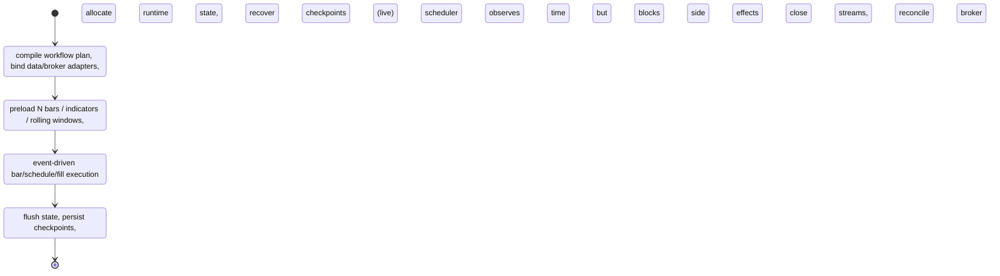
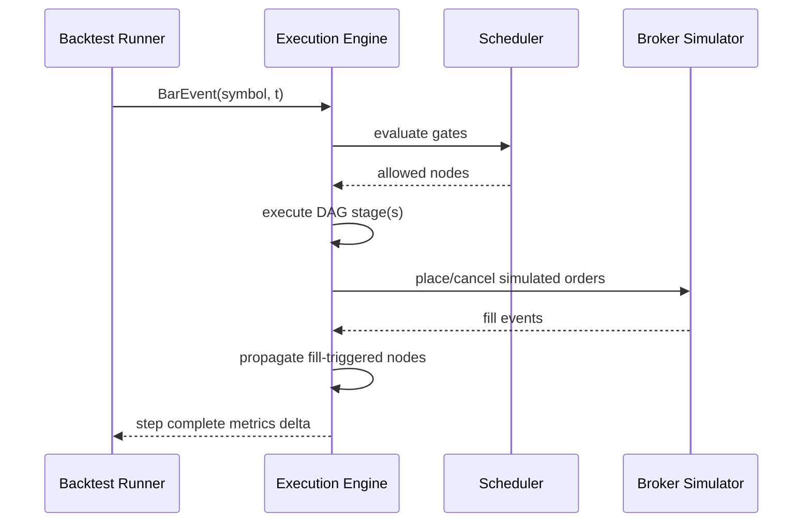

# Coreza Trading OS Architecture RFC

**Status:** Draft v1  
**Date:** 2026-04-05  
**Audience:** Workflow engine engineers, quant researchers, infra/platform team

## Assumptions

1. Workflows are DAGs with explicit control/data edges and versioned definitions.
2. Market data time is canonical for bar-driven strategy execution.
3. Scheduler nodes are mandatory gates for strategy/execution nodes in both backtest and live.
4. Backtest reproducibility is a first-class contract (same inputs => same outputs).
5. Live mode permits bounded non-determinism (latency, partial fills), but all side effects are idempotently logged.

---

## A) Coreza Mental Model

### Execution lifecycle



### Separation of concerns

| Layer | What it is | What it is not |
|---|---|---|
| Workflow Definition | User-authored graph (nodes, edges, params, constraints) | Mutable runtime memory |
| Execution Engine | Deterministic event dispatcher + node runtime contract | UI model or broker SDK |
| Runtime State | Ephemeral + persisted execution context (indicators, portfolio, node state) | Workflow schema |

### Coreza vs n8n vs QuantConnect

| Dimension | n8n | QuantConnect | **Coreza** |
|---|---|---|---|
| Authoring | Visual business automation | Code-first strategy class | Visual graph + quant semantics |
| Clock | Trigger/webhook-centric | Time/bar loop | Unified scheduler + bar/event clock |
| Runtime parity | Not trading-focused | Backtest/live via code parity | **Same workflow graph for backtest/live** |
| Side effects | APIs/CRUD | Orders/portfolio | Orders + infra side effects with explicit isolation |

---

## B) High-Level Architecture

```mermaid
flowchart LR
    UI[Workflow Builder UI] --> REG[Workflow Registry\n(versioned definitions)]
    REG --> COMP[Workflow Compiler/Planner]
    COMP --> PLAN[Executable Plan DAG]

    MD[Market Data Layer] --> BUS[Event Bus]
    SCH[Scheduler Service] --> BUS
    BRK[Broker Abstraction Layer] --> BUS

    PLAN --> ENG[Execution Engine]
    BUS --> ENG
    ENG --> STATE[State & Storage Layer]
    ENG --> BRK

    subgraph Modes
      BTR[Backtest Runner] --> ENG
      LVR[Live Runner] --> ENG
    end

    STATE --> MET[Metrics/Analytics]
```

### Component intent

- **Workflow Compiler / Planner:** validates DAG, inserts execution barriers/gates, computes topological stages, and freezes deterministic plan hash.
- **Execution Engine:** single source of truth for node invocation contract and event ordering.
- **Backtest Runner:** deterministic event producer from historical bars.
- **Live Runner:** real-time producer with recovery and reconciliation loops.
- **Market Data Layer:** normalized bars/ticks, session calendars, symbol routing.
- **Broker Abstraction Layer:** uniform order/fill/position model across Alpaca/Binance/etc.
- **State & Storage Layer:** hot state cache + append-only event log + checkpoints.

---

## C) Node Execution Model (Critical)

### Invocation contract

Node executes **only** when:
1. Upstream dependencies for current execution boundary are satisfied.
2. Scheduler gate for node (or ancestor strategy lane) is open.
3. Node-specific readiness (warmup complete, required state available) is true.

### Input context

```ts
interface NodeExecutionContext {
  mode: "backtest" | "live";
  workflowId: string;
  runId: string;
  sessionId: string;
  logicalTime: string;     // event time (bar close/open policy-defined)
  eventType: "bar" | "schedule" | "fill" | "system";
  symbols: string[];
  marketDataSlice: Record<string, Bar | Tick>;
  portfolioSnapshot: PortfolioState;
  brokerSnapshot?: BrokerState;
  nodeState: unknown;      // opaque per node
  inputs: Record<string, unknown>; // resolved upstream payloads
}
```

### Output contract

```ts
interface NodeExecutionResult {
  outputs: Record<string, unknown>;   // routed on data edges
  commands: EngineCommand[];          // e.g., PlaceOrder, CancelOrder, EmitSignal
  statePatch?: unknown;               // persisted node-local state delta
  audit: { deterministicHash: string; latencyMs: number };
}
```

### Stateful vs stateless

- **Stateless nodes** (pure transforms, conditions): output = f(inputs, context).
- **Stateful nodes** (indicators, rolling windows, risk accumulators): read/write explicit node state namespace.
- Stateful node updates are applied atomically after execution; failed commits do not partially mutate state.

### Backtest vs live behavior

| Aspect | Backtest | Live |
|---|---|---|
| Time source | Historical stream iterator | Real-time feed timestamps |
| Fill model | Simulator (slippage/commission model) | Broker callbacks + reconciliation |
| Retry | Deterministic replay on failure | Idempotent retry with dedupe keys |
| Side effects | Simulated only (except logs/metrics) | Real orders + external notifications |

### Side-effect isolation

- Strategy computation lane is pure until `EngineCommand` boundary.
- Side-effect executor applies commands with idempotency key: `{workflowId}:{runId}:{nodeId}:{seq}`.
- Command ledger enables exactly-once *logical* semantics despite at-least-once delivery infra.

---

## D) Scheduler & Time Control

### Scheduler types

1. **Cron schedule nodes:** “every weekday 09:35 America/New_York”.
2. **Bar index schedule:** every N bars, or bar offset from session open.
3. **Session-aware guards:** pre-market/regular/post-market policy.
4. **Warm-up gates:** block execution until `warmupBars >= requiredBars`.

### Gating semantics

```mermaid
flowchart TD
    E[Incoming Event] --> G{Scheduler gate open?}
    G -- No --> H[Record skipped decision\n(reason, time, node)]
    G -- Yes --> X[Execute node]
```

- If not met: node does not execute; decision is logged for replay transparency.
- Missed/delayed bars (live):
  - If bar arrives late but within tolerance window, process with original event time.
  - If beyond tolerance, emit gap event; strategy can choose skip/catch-up mode.

---

## E) Data & State Management

### Storage strategy

| State type | Backing | TTL/Retention | Notes |
|---|---|---|---|
| Hot runtime state | Redis/in-memory | session-lifetime | Fast node access |
| Event log | Append-only durable store | long retention | Replay + audit |
| Checkpoints | Object store / DB | periodic snapshots | Crash recovery |
| Historical bars | Columnar/time-series store | long retention | Deterministic input dataset |

### Guarantees

- **Backtest isolation:** each run uses unique namespace; no shared mutable portfolio or indicators.
- **Live recovery:** restore latest checkpoint + replay uncommitted ledger entries + broker reconcile.
- **Deterministic replay:** plan hash + input data version + config hash + seed fully define replay identity.

---

## F) Backtesting Engine Design

### Deterministic bar loop



### Multi-symbol support

- Clock advancement uses merged time frontier across symbols.
- Node contexts receive symbol slices based on declared dependencies (not full universe by default).
- Portfolio node always sees full account state.

### Metrics computation

- Incremental ledger: equity curve, returns series, drawdown, exposure, turnover.
- End-of-run analytics: Sharpe/Sortino, max DD, win rate, expectancy, hit ratio.
- Metrics computed from canonical event/fill ledger, not ad-hoc node outputs.

---

## G) Live Trading Engine Design

### Runtime responsibilities

1. Subscribe to market/broker streams.
2. Maintain local mirrored state with sequence numbers.
3. Apply reconciliation loop at startup and periodic intervals.
4. Provide safety controls: pause, resume, kill-switch liquidate.

### Reconciliation strategy

- Startup:
  - Pull broker open orders/positions/cash.
  - Compare with internal ledger snapshot.
  - Generate corrective intents (adopt, cancel, hedge, or hard-stop).
- Continuous:
  - Detect drift via checksum of positions/orders.
  - Auto-heal when possible; escalate otherwise.

### Idempotency and retries

- All broker commands carry client order ID derived from deterministic idempotency key.
- Retry policy: exponential backoff + jitter + max-attempts + dead-letter channel.
- On uncertain commit (timeout), fetch broker state before reissuing.

### Fail-safe behavior

| Failure | Default action |
|---|---|
| Market data outage | Pause strategy lane; keep risk monitor running |
| Broker API outage | Freeze new entries; allow protective exits when channel restores |
| State store unavailable | Enter degraded mode; if persistence unavailable beyond threshold, halt trading |
| Reconciliation mismatch severe | Trip kill-switch policy (optional auto-liquidate) |

---

## H) Trade-offs & Explicit Decisions

### Optimized for

1. **Determinism:** explicit time gating and event ordering.
2. **Clarity:** nodes execute only on declared events and schedule gates.
3. **Extensibility:** adapters for data and brokers; stable execution contract.

### Intentionally avoided

- Hidden implicit triggers.
- Nodes polling external data directly.
- Silent best-effort retries without audit trail.

### Simplicity over peak performance

- Prefer single logical event loop per workflow session in v1/v2.
- Use coarse-grained batching and explicit backpressure before micro-optimizing.
- Keep deterministic replay machinery even if it adds storage overhead.

---

## I) Evolution Roadmap

### v1 (single worker / single broker)

- One workflow session process.
- One broker adapter (e.g., Alpaca).
- Deterministic backtest and baseline live parity.
- Redis hot state + durable event log.

### v2 (distributed execution)

- Partitioned workers by workflow/session.
- Redis Streams or Kafka for event transport.
- Central scheduler service with lease-based ownership.
- Exactly-once logical command ledger across workers.

### v3 (multi-tenant + higher frequency)

- Tenant-isolated execution pools.
- Sub-minute/event-driven strategies with tighter latency budgets.
- Advanced risk gateway and broker smart routing.
- Stateful stream processing for indicators/portfolio aggregation.

---

## Implementation guardrails

1. Every node type must declare: trigger types, required warmup, state schema, side-effect capability.
2. Engine rejects workflows where strategy/execution nodes are not scheduler-gated.
3. Replay tests are mandatory for all stateful nodes and broker command handlers.
4. Live and backtest share execution core; mode-specific logic only in adapters.

This RFC defines Coreza as a **trading operating system kernel** with a visual strategy surface, not a generic workflow SaaS runtime.
