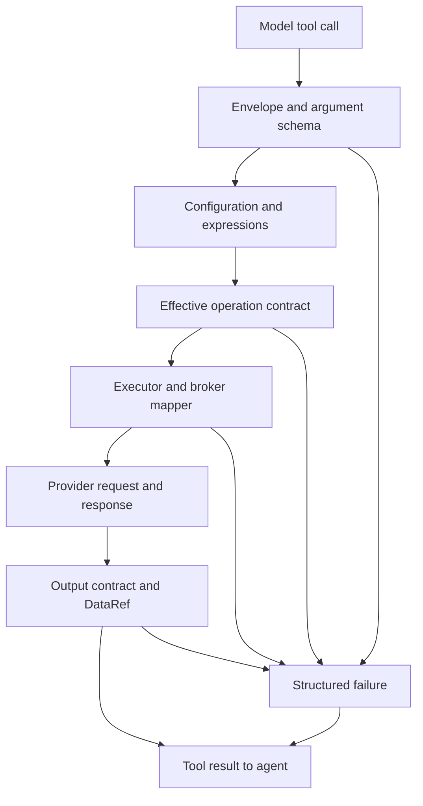

# AI Agent Tool Validation and Market-Data Reliability Plan

Status: **Revised plan only — no runtime implementation**  
Target branch: `dev`  
Review date: 10 November 2026  
Reviewed source: [`fbddc0dc328135ecb47b34c76a080ad3f78b389f`](https://github.com/Coreza-io/coreza/tree/fbddc0dc328135ecb47b34c76a080ad3f78b389f)

## 1. Decision and intended outcome

Keep TypeScript, Zod, LangChain and Coreza's existing executors. Python/Pydantic or MCP would not by themselves fix these failures.

The problem spans **tool construction, input resolution, broker mapping, error delivery and output interpretation**. A second Zod parse alone is insufficient: a correct call can be blocked before that parse, a later mapper can change its meaning, and an informative provider failure can become a generic message.

Build a shared tool boundary with operation-specific contracts, then deliver a complete Alpaca historical/latest-bars pilot. Preserve configured settings and existing DataRef/indicator protections. Expand by actual node and operation coverage, rather than claiming every node is fully validated because it passes through the hook.

The first usable release must:

- Expose the correct editable fields; apply requirements to the selected operation and asset.
- Validate resolved configured values as well as model arguments before execution.
- Ensure endpoint mapping preserves those validated values.
- Return safe, structured errors that the agent can act on within its existing execution budget.
- Distinguish valid empty data, malformed responses, partial coverage, permission failures and local input errors.
- Never silently switch feed, symbol, interval, account, environment or an explicit date range.

Out of scope for the pilot: strategy/portfolio changes, database migrations, a new validation service, broad editor redesign, automatic trading retries, a market-calendar subsystem, and automatic IEX/SIP substitution.

## 2. Findings and corrections to the previous plan

These findings come from static inspection of pinned `dev` source. They identify code paths and failure mechanisms. This review did not use live broker credentials or rerun the user's original request.

| Priority | Verified finding | Consequence | Required change |
| --- | --- | --- | --- |
| P0 | `generateSchemaFromNode` checks display conditions against saved fixed controller values. With editable/expression operation or asset, unrelated dependent fields can remain required. | A request can fail before the effective validator runs. | Fix conditional schema construction with the shared hook. Enforce uncertain requirements after resolution. |
| P0 | Generated `z.object(...)` schemas strip unknown keys. Nested `input` is unwrapped inside `func`, after LangChain's parse. | A wrapper or a wrong field such as `timeframe` can disappear before intended handling sees it. | Normalize supported envelopes before parsing; diagnose unknown parameters for reviewed contracts. |
| P0 | The overridden `invoke` logs `ToolInputParsingException`, then rethrows it. The callback cannot catch this failure. | Coreza itself does not produce the same recoverable tool result for schema and callback failures. | Handle both boundaries; verify framework delivery with the installed LangChain version. |
| P0 | Configured values/expressions merge after the first parse without a common semantic contract. | Valid model input does not establish valid executed input. | Validate the final object and use that same result for node values, executor input and resolver snapshot. |
| P0 | Broker errors can become provider response text; `AIAgentExecutor` then throws `new Error(result.error)`. | HTTP status, provider code and reconciliation details can be lost. | Preserve a safe subset of `NodeResult.details`; classify before flattening errors. |
| P1 | Alpaca limit uses `Math.min(Number(input.limit) || 10000, 10000)`. | Invalid text/zero can become 10000; negative/fractional values are not reliably rejected. | Validate explicit values before fallback; retain the omitted-value default. |
| P1 | Historical/latest stock feed choices share UI metadata. Historical mapping forwards `feed` for crypto; both operations may forward crypto `currency`. | UI-valid settings can be incompatible with the endpoint. | Use operation-specific feed rules and endpoint parameter allowlists. |
| P1 | Broker crypto normalization checks `assetType`; Alpaca HTTP also reads `asset_type`. Crypto UI input is `crypto_base`. | Alias-only requests can choose a crypto URL without identical symbol normalization. | Canonicalize reviewed aliases and configured authority before dispatch. |
| P1 | Auto-pagination defaults to true and `max_pages` to 100. Tool summaries drop page-completion metadata. | `limit=100` does not mean 100 total/latest bars; incomplete coverage can look complete. | Separate page size from requested count and preserve pagination metadata. |
| P1 | Historical DataRef extraction requires one matching symbol/timeframe; Alpaca HTTP accepts multiple symbols. | A remote success can fail during local series selection. | Pilot: one symbol per historical agent call; preserve ordinary broker multi-symbol support. |
| P1 | Historical zero rows already produce `no_data`, but little request context. Latest bars bypass this historical branch. | Empty latest data can pass through as a successful-looking generic result. | Classify outputs by operation, including historical/latest emptiness. |
| P1 | Latest-bar transforms use `input.interval || '1m'`, although the endpoint returns minute bars. | A stale saved interval can mislabel the observation. | Derive timeframe from the latest endpoint. |
| P2 | UI metadata is not always an executable tool contract. GoogleWebSearch lacks `query`, required by its executor; repeaters fall through to string conversion. | Required executable arguments can be omitted or structured inputs misrepresented. | Audit metadata/executor agreement, complex field types, identities and routing during expansion. |

### What the IEX/SIP incident establishes

The user reported an empty IEX request and a working SIP request. Treat that as evidence that feed choice mattered in that case. It does **not** prove that IEX is generally invalid, that entitlement caused the empty response, or that Coreza should switch feeds automatically. The exact original requests were not reproduced here.

A semantically valid request can have zero observations. Validation must constrain requests and explain outcomes; it cannot manufacture trading activity or guarantee availability. Preserve the distinction between local rejection, provider failure and valid emptiness.

## 3. Execution path and contract boundaries

The connected-node path is `AIAgentExecutor.createToolsFromEdges` → `createToolFromNode` → executor registry. `nodes/logic/agentSystem.ts` is a separate agent implementation; changing it alone does not fix this path.



| Contract | Responsibility | Avoid |
| --- | --- | --- |
| Model arguments | Describe editable fields in provider-compatible JSON schema and validate basic shape. | Inactive required fields, editable fixed credentials/settings, silent argument loss. |
| Effective runtime input | Validate the selected operation after configuration/expressions and applicable reference handling. | Parsing resolved arrays with text-only UI types or applying defaults twice. |
| Broker/output | Preserve meaning through endpoint mapping; validate response and coverage. | Treating HTTP 200 as usable data or losing provider/page details. |

Indicators intentionally resolve DataRefs in `IndicatorsExecutor`. Preserve that ownership. The shared hook validates scalar controls; existing indicator code checks references, candles and readiness. Do not eagerly resolve indicator arrays again for a generic UI parse.

## 4. Shared contract design

Add a small helper such as `coreza-backend/src/nodes/logic/effectiveToolInputValidation.ts`. Key its registry by **resolved executor/broker identity + operation**, with node-specific contracts for indicators/utilities. Generated tool names and suffixes are not stable validator identifiers.

A contract records:

- Known editable/runtime fields, conditional requirements, aliases and safe scalar normalization.
- Risk: read-only, state mutation, external communication/trading, or unsupported synchronous execution.
- Coverage: field-only, operation-reviewed, or legacy/unreviewed.
- Optional output classifier and recovery eligibility. Missing entries never imply complete validation.

`validateEffectiveToolInput(...)` returns validated input plus small diagnostics, or a typed failure. Execute the parsed result, including reviewed scalar transformations. Do not parse successfully and then execute the original object. This helper must not select feeds, rewrite date ranges, infer accounts or perform per-call remote lookups.

Keep cross-field refinements in runtime contracts. The model-facing schema must remain convertible by current OpenAI/Gemini adapters. No Zod major-version change or provider-incompatible schema effects are needed.

### 4.1 Fix argument schemas before semantic validation

Evaluate field applicability with three states:

1. **Known active:** fixed controllers select the field; expose it if editable and retain its requirement.
2. **Known inactive:** omit it and do not inject its default.
3. **Unknown until execution:** a controller is editable or an expression; expose dependent fields as optional and enforce requirements after resolution.

Apply the same rule to dependent defaults. A stock feed, order side or order type must not appear as a model choice for an unrelated operation. Apply established defaults once after applicability is known. Track origins: model, schema/node default, configuration, expression, broker mapping or unspecified provider default.

For reviewed Alpaca contracts, inspect meaningful raw arguments before stripping. For unsupported `timeframe`, say to use `interval`. Do not accept arbitrary raw fields or make every legacy tool globally strict. Maintain an explicit list of reviewed runtime-only fields such as pagination controls.

If preserving `{input:{...}}` support, unwrap that transport envelope **before** parsing. Retain LangChain ToolCall ID/name/type and normalize only its arguments. Define conflicting inner/outer key behavior; do not reinterpret a real business field named `input`. Preserve the existing fallback schema deliberately instead of flattening arbitrary objects.

### 4.2 Configuration, aliases and effective values

Retain `parameterEntries` and `isConfiguredToolValue` semantics, including meaningful `false` and `0`. Blank saved fields do not erase generated values. Editor field-mode metadata remains excluded from executor parameters.

Precedence: resolved configured value → model-supplied value → applicable existing default. A configured expression resolving to an invalid/missing required value is a **configuration failure**; the model must not replace it.

Resolve alias groups with source-aware authority. A fixed `assetType` cannot be bypassed through generated `asset_type`, and a fixed crypto pair cannot be replaced through another symbol alias. Normalize reviewed aliases once; reject unresolved same-authority conflicts. Do not spread raw configuration back over validated results afterward.

Call the effective validator after saved expressions and applicable non-indicator DataRefs resolve, before execution. Pass the same validated values to `normalizedNode.values`, executor input and the tool-context resolver snapshot. Never mutate the saved node.

For unreviewed nodes, retain compatibility with an explicit field-only/legacy coverage marker. Apply only proven safe common checks. Missing metadata produces a trace diagnostic rather than false full-validation coverage.

## 5. Alpaca pilot: input and endpoint contracts

Implement `get_candle` and `get_latest_bar` first. Reuse broker identity resolution and `validateAlpacaCryptoSymbol`. Keep endpoint construction beside Alpaca operations.

Guard the final mapper as well: later normalization must not alter validated meaning. Reuse pure contract rules at both boundaries where necessary; do not duplicate validators/default application. Preserve supported normal-workflow multi-symbol requests. Explicitly invalid scalar values must no longer get silent fallback.

### 5.1 Endpoint matrix

| Operation / asset | Endpoint | Request mapping |
| --- | --- | --- |
| Historical stock | `/v2/stocks/bars` | `symbol` → `symbols`; `interval` → `timeframe`; supported dates, limit, sort, stock feed, adjustment, currency and page token. |
| Latest stock | `/v2/stocks/bars/latest` | Symbols, latest stock feed and currency; no requested aggregation/range. |
| Historical crypto | `/v1beta3/crypto/us/bars` | Validated full pair → symbols; timeframe, dates, limit, sort and supported page token. No stock feed, adjustment or currency. |
| Latest crypto | `/v1beta3/crypto/us/latest/bars` | Validated full pair → symbols; minute aggregation belongs to the endpoint. No stock-only or historical controls. |

Official documentation checked on the review date lists historical stock feeds `sip`, `iex`, `otc`, `boats`; latest stock bars additionally list `delayed_sip`, `overnight`. Split operation-dependent choices/descriptions accordingly. Never translate `overnight` to `boats` or `delayed_sip` to `sip` silently. Feed enum membership does not prove entitlement.

Existing nodes can retain hidden settings. For crypto/latest, omit irrelevant saved fields from the endpoint query and trace ignored field names while preserving workflow configuration. A newly supplied incompatible argument gets an actionable error. A crypto node must not fail merely because an old hidden stock default remains saved.

### 5.2 Symbols, assets and intervals

- Pilot assets: stock and crypto, with reviewed aliases and configured precedence.
- Historical agent calls select one symbol/pair because one DataRef identifies one series. Multiple tickers require separate calls. Multi-series references are a separate feature.
- Crypto UI uses `crypto_base`. Carry its validated canonical `symbol` through execution and output processing so series selection checks the actual requested pair. No fabricated fallback pair.
- Historical intervals remain the node's supported `1Min`, `5Min`, `15Min`, `1Hour`, `1Day`. Do not broaden them just because Alpaca permits more.
- Latest results describe a minute observation and its timestamp. Ignore stale saved historical intervals. Empty latest data is `no_data`; previous-session data may be valid without being current.

### 5.3 Numeric and date rules

- `limit` is page size. Accept an explicit finite integer from 1 through 10000, including a reviewed numeric-string form. Reject malformed text, booleans, objects, zero, negatives, fractions and non-finite values before HTTP.
- Preserve Coreza's absent/blank limit default of 10000. Do not silently cap or default explicitly invalid values.
- Accept API-supported YYYY-MM-DD dates and RFC-3339 timestamps with explicit timezone. Check actual calendar validity, not `Date.parse` alone or format-only regex. Preserve valid fractional-second precision and the represented instant.
- Reject `start > end`. The endpoint documents inclusive bounds; do not impose the earlier blanket `start < end` requirement without verifying that equality is forbidden. Equal dates must not automatically expand into a full trading day.
- Do not universally reject future ends, require both dates for every intraday call, or rewrite timezone boundaries. Omitted dates retain provider semantics and are reported as omitted/defaulted, not invented exact timestamps.
- Preserve stock adjustment combinations already supported by the mapper, such as `split,spin-off`. The exposed select enum cannot represent that combination today. Permit a reviewed string form for the pilot or explicitly document its restriction; never reject valid saved combinations through a select-only second parse.

### 5.4 Pagination and request budgets

Retain current auto-pagination/defaults unless separately changed. Validate reviewed controls: boolean `auto_paginate`; bounded positive-integer `max_pages`. Proposed pilot ceiling: existing default of 100 pages. An absent value retains it; negative values must not silently mean one page.

Expose supported controls in the tool schema even if absent from editor JSON. Preserve `pages_fetched`, `pagination_complete`, `has_more`/next-page availability in summaries. Keep opaque tokens out of logs; expose one only for a documented continuation contract.

A page is part of one logical read, not a retry. A page ceiling with more data available means partial coverage, even if the selected symbol has no rows yet. Do not call that complete `no_data`. A later-page failure must not silently return earlier pages as complete success.

No retry/date expansion belongs inside the pilot pagination loop. Check cancellation between pages and pass the agent signal to pilot Axios calls. Existing checks before/after executor execution do not establish prompt in-flight cancellation. Bound rows/memory through existing DataContext limits and report a resource limit distinctly rather than silently truncating arrays.

## 6. Error contract: deliver actionable evidence to the agent

Use one additive tool failure envelope. Preserve existing `success`, `type`, `summary`, `rowCount`, `cached` and DataRef fields where applicable. These are **tool-result outcomes**, not new canonical workflow `NodeResult.status` values.

| Tool outcome | Evidence | Response policy |
| --- | --- | --- |
| `invalid_input` | Local reviewed contract failed. | Correct editable arguments; zero provider requests. |
| `configuration_error` | Invalid/missing fixed setting or expression. | User fixes node; model cannot overwrite it. |
| `provider_invalid_input` | Provider parameter rejection despite local acceptance. | Safe reason/field; record contract gap. |
| `authentication_failed` | Verified authentication failure. | No same-request retry or replacement credentials. |
| `permission_denied` / `feed_not_entitled` | Verified forbidden response; entitlement subtype needs provider evidence. | No feed/account substitution. |
| `rate_limited` | Verified rate-limit response. | Optional later read recovery may honor safe delay. |
| `upstream_error` / `timeout` | Transport/provider failure. | Distinct from empty data. |
| `invalid_output` | Malformed response/candles or mismatched series. | No successful DataRef. |
| `no_data` | Recognized valid response, zero observations, understood coverage. | Explain request; no identical automatic replay. |
| `not_ready` | Existing indicator readiness needs more observations. | Preserve required/observed counts and current semantics. |
| `success` | Valid usable result. | Completeness remains independent; success can contain partial coverage. |

Implementation requirements:

1. Handle schema failures outside `func` and semantic failures inside it. Use one invocation identity and final trace for either path. Preserve the original framework tool-call ID when returning a ToolMessage.
2. Verify the lockfile/installed LangChain behavior. Extend the existing invoke boundary if it can safely return the expected failure result; otherwise use one supported tool-call error adapter. Do not add duplicate handlers or assume logging an exception allows correction.
3. Preserve safe provider evidence before converting errors to text. Reuse existing `NodeResult.details`; stop replacing structured failures with `new Error(result.error)` in the agent adapter.
4. Keep provider numeric codes, local string codes and HTTP status separate. A generic 403 does not prove a subscription issue. Model-facing text needs a bounded allowlist/sanitizer. `safeToolError` deliberately omits raw messages and is not itself an actionable error formatter.
5. `retryable_by_agent` means an editable correction can help. It is false for fixed-field failures, entitlement failures and automatic mutation replays. Distinguish correcting arguments from transport retries.
6. Cancellation propagates as cancellation. Listening/waiting/streaming states must not become completed successful fetches merely because their status is not `error`.
7. Preserve order-status-unknown/reconciliation details. No order replay, idempotency redesign or whole-agent retry after a mutation is authorized by this plan.

Example local rejection:

```json
{
  "success": false,
  "status": "invalid_input",
  "type": "tool_error",
  "operation": "get_candle",
  "toolInvocationId": "<invocation>",
  "issues": [{
    "field": "limit",
    "code": "invalid_positive_integer",
    "source": "model",
    "editable": true,
    "message": "limit must be an integer from 1 through 10000"
  }],
  "retryable_by_agent": true,
  "provider_request_sent": false
}
```

Do not echo rejected raw values, credentials, expressions or full provider responses. Bound issue count and field-path length. Track provider dispatch from the actual transport boundary, not just that the executor started.

## 7. Output contracts, DataRefs and empty-data diagnostics

Reuse `extractHistoricalCandles`, `normalizeCandles`, `ToolInvocationRefs` and DataContext lifecycle. They already protect immutable candles, reject invalid/mixed series, check symbol/timeframe provenance, and avoid successful historical references for zero rows.

Do not duplicate OHLCV math, copy full candle arrays into the model context, or describe these existing protections as new fixes.

Add an operation-aware output adapter:

- Recognize actual historical operations and executor identity. The current list misses cases such as Schwab `get_price_history`; input validation alone will not produce a compatible DataRef. Inspect response shape before extending recognition.
- Separate recognized empty bars from a missing/malformed container. Alpaca currently uses `raw?.bars ?? {}`, which can conceal a missing container. Validate shape before synthesizing emptiness.
- Preserve requested symbol, asset, feed, interval, applicable adjustment/currency and supplied dates. Label unspecified provider defaults honestly. Server `requestedAt` does not establish exchange session state.
- Keep first/last observation times, returned count, page count and completeness. Fewer rows than `limit` is not itself evidence of missing data.
- Latest bars return a compact validated minute snapshot with its actual timestamp. Do not imply that one observation provides historical indicator warm-up.
- Malformed containers, invalid candles, symbol mismatch or unresolved references are failures, not legitimate zero-data results.

Example recognized empty historical result:

```json
{
  "success": false,
  "status": "no_data",
  "type": "market_data",
  "rowCount": 0,
  "cached": false,
  "summary": {
    "symbol": "RKLB",
    "timeframe": "5Min",
    "feed": "iex",
    "requestedRange": { "start": null, "end": null },
    "rangeSource": "provider_defaults",
    "returnedBarCount": 0,
    "paginationComplete": true,
    "message": "No candles returned. Check the requested session and feed coverage."
  },
  "retryable_by_agent": false,
  "provider_request_sent": true
}
```

Null dates above mean omitted arguments, not known missing observations. No entitlement conclusion follows from this result. Candidate causes must be labeled hypotheses unless confirmed by provider/calendar evidence.

Add concise agent instructions naming `no_data` and `invalid_output`, requiring timestamps for current-market claims, and preserving explicit feed/date intent. Prompt guidance supplements runtime controls; it cannot guarantee truthful final answers. Market closure does not invalidate historical observations, and a successful latest request does not prove freshness.

## 8. Diagnostics and concurrency

Extend existing `toolExecutionLog.ts` traces. Generated/configured/effective snapshots, page/request counts, HTTP status, normalization timing and row counts already exist.

Add only missing information:

- Phase: schema/effective/broker mapping/output; contract ID/version and coverage.
- Safe issue field/code/source/editability; actual provider dispatch.
- Ignored field names, default origins, requested-versus-transmitted differences and page completeness.
- Correction/recovery linkage only for an actual attempt; pages are separate from retries.

Emit exactly one `tool_completed` per started invocation. Schema failures have zero HTTP requests. Preserve existing not-ready/activity behavior. Keep parallel-call state invocation-local; never put a last-request error or metadata field on a shared executor instance.

Use existing redaction and bounded payload handling. No API keys, account/order IDs, opaque tokens, raw error objects, full candle arrays or unbounded expressions. Do not expose all response headers/details to retain one useful code.

## 9. Recovery and last-N bars: separate follow-on work

The pilot returns actionable errors and diagnostics. It adds no automatic transient retries or implicit historical-window expansion.

### 9.1 Corrections and bounded execution

Let the model correct editable parameters within its existing graph budget. `maxIterations` currently feeds LangGraph `recursionLimit`; it is not a guaranteed count of tool retries. Do not silently increase it.

A later invocation-local duplicate policy may suppress equivalent repeated invalid/empty calls. Key it by node, operation and canonical effective parameters, with cleanup on teardown. Do not introduce global market-data suppression.

### 9.2 Optional transient read retries

After pilot acceptance, use one retry owner with an explicit allowlist of historical/latest reads and verified transient errors. Proposal: at most one additional attempt within a total request/time budget that includes pagination.

Honor cancellation/rate limits. Do not stack framework, agent and broker retries. No retries for invalid inputs, authentication/permission failures, malformed output, emptiness or any trading/communication/state mutation. A mutation timeout may require reconciliation.

### 9.3 Explicit last-N intent

Never reinterpret `limit` as latest N bars; Coreza forwards page size, usually ascending with auto-pagination.

If adding lookback later, represent requested count separately from a bounded range. Use a small reviewed broker/tool enhancement, not invisible generic date injection. It must:

- Define stock sessions, holidays, half-days and DST versus 24/7 crypto.
- Define inclusion of the current incomplete bar, end cutoff and feed delay.
- Bound expansion, pages, rows, memory and elapsed time; sparse trading can prevent N observations.
- Preserve explicit feed/symbol/interval/timestamps; never expand an explicitly bounded request.
- Return requested and actual count, resolved range and completeness separately from page size.

Until then, suggest an explicit historical session/range when needed. Do not silently substitute a prior day to answer a question explicitly about today.

## 10. Coverage across converted nodes

Every connected tool uses the shared boundary; operation validation expands incrementally. This review inventoried **73 frontend JSON definitions** and inspected the common agent path, Alpaca mapping, representative indicator execution, Tool/DataSource executors and result contracts. It did not execute or deeply audit every provider operation.

Expansion must produce a checked-in coverage table per actually attachable tool and operation: definition/runtime identity, executor route, argument schema, effective checks, executor checks, output classification, risk and recovery. Include capability/static legacy aliases. JSON presence does not prove synchronous tool support.

| Group | Definitions / identities to reconcile | Main review requirement |
| --- | --- | --- |
| Brokers | Alpaca, Binance, Schwab, Dhan, FinnHub | Provider operation/date/asset contracts; separate reads and mutations. |
| Data/news/screeners | Market, YahooFinance, Polygon, FMP, FMPNews, AlpacaScreener, BinanceScreener, SchwabScreener, YahooFinanceScreener, FMPScreener | Different historical operation names/shapes; news/profile data are not candles. |
| Indicators | ADX, ATR, BB, EMA, Ichimoku, MACD, OBV, RSI, Stoch, SupportResistance, VWAP, VolumeOscillator, InitializeIndicators | Scalar windows/relationships; preserve readiness/provenance; initialization can change state. |
| Windows/state | Consolidator, RollingWindow, InMemory, Store, RedisStore | Read versus write/delete/publish, structured values and state scope. |
| Logic/risk | Compute, Field, If, Loop, Switch, RiskEngine | Repeaters/objects/expressions, nested execution and state changes. |
| Portfolio/backtest | Portfolio, BacktestInit, BacktestPortfolio, BacktestResults, BacktestTrade, OnBar | Operation-specific state/trade effects and runtime identity. |
| Fetch/utilities/output | DocumentExtract, GoogleWebSearch, HttpRequest, Visualize | Required executable arguments, output shape, routing and method-dependent risk. |
| Communication | Gmail, Telegram, WhatsApp | External sends are side effects; no generic replay. |
| Agent/input/model/memory | AIAgent, ChatInput, OpenAI, OpenAIChatModel, GeminiChatModel, SimpleMemory, RedisChatMemory, PostgresChatMemory | Dependency handles versus executable tools; nested recursion/context/routing. |
| Streams/subscriptions | AlpacaStreamData, AlpacaSubscribe, BinanceStreamData, BinanceSubscribe, DhanStreamData, DhanSubscribe, SchwabStreamData, SchwabSubscribe | Filename/runtime-name differences, lifecycle effects and synchronous eligibility. |
| Triggers | GmailTrigger, RedisTrigger, Scheduler, TelegramTrigger, WebhookTrigger | Confirm tool support; listening/scheduled is not completed data. |

Concrete expansion requirements:

- **Schwab:** actual operation is `get_price_history`. Validate period/frequency combinations and executor date conversion; review DataRef output recognition with input rules.
- **Binance/Dhan:** inspect actual timestamp units, intervals, instrument IDs and environment rules. Do not copy Alpaca feed/date assumptions.
- **Indicators:** RSI/EMA expose `window`; ATR uses `period`; MACD uses `fastPeriod`, `slowPeriod`, `signalPeriod`; BB uses `period`, `std_dev_multiplier`. Preserve actual names, integer constraints where appropriate, period relationships, existing finite-value checks, exact refs and `not_ready` behavior. Do not duplicate indicator math/warm-up formulas.
- **Metadata gaps:** GoogleWebSearch needs `query`; its executor expects context `user_id` while the agent path uses `userId`. Verify and normalize context at the adapter without letting the model author identity. Review `Field` repeaters and structured defaults instead of `String(default)` conversion.
- **Identity/routing:** names such as “Bollinger Bands”/“Edit Fields,” aliases `BB`/`Field`, static entries `SMA`/`Date`, and capability-only trade/news names must resolve correctly. Do not assume all listed entries work today.
- **Mutations:** preserve credential scope, configured account/environment and idempotency/reconciliation. The hook does not replace those controls. Strict mutation contracts need separate operation reviews; the pilot cannot claim complete mutation safety.

## 11. Delivery slices and files

Replace the old hook-only PR followed by separately delayed essential validation/diagnostics. An unused registry does not fix the reported issue. Each slice needs a visible acceptance result.

| Slice | Deliverable | Main files |
| --- | --- | --- |
| 1: complete Alpaca pilot | Conditional schemas/envelopes; effective helper; historical/latest contracts; safe error delivery; endpoint mapping; empty/partial output context. Dependent commits may be separate, but ship together. | `AIAgentExecutor.ts`; new `effectiveToolInputValidation.ts`; adjacent Alpaca validation helper; Alpaca `http/operations.ts`; narrowly scoped `BrokerExecutor.ts`; `toolOutputProcessor.ts`; `src/nodes/Alpaca.json`. |
| 2: inventory and expansion | Checked coverage table; resolve demonstrated metadata/routing gaps; indicator scalar checks and one broker at a time with its output adapter. | `toolDefinitions.ts`, relevant JSON/executors and broker helpers; coverage document. |
| 3: optional recovery | One bounded transient-read retry owner; explicit last-N feature only if requested. | Existing read path plus a small policy helper; no generic replay mechanism. |

Change `toolExecutionLog.ts` only for missing diagnostics. Normally keep `NodeResult` contract files unchanged: use existing `details`/`meta` and introduce tool-facing outcomes in the adapter. Carry only safe request/coverage metadata through result envelopes, never raw Axios objects.

Shared mapper changes may affect manual/backtest/live callers. Separate intentional invalid-value rejection from agent-only restrictions such as a single historical series. No broad workflow-engine refactor is required.

## 12. Verification and acceptance

This revision changes documentation only. The checks below are future implementation requirements, not claims that tests or runtime fixes have been completed.

Use focused offline checks with mocked transport/executors. No live order, subscription mutation or message send is needed. Verify the actual outgoing request and next agent observation, rather than mirroring the validator's implementation.

| Scenario | Required evidence |
| --- | --- |
| Fixed account operation, editable operation and expression-selected operation | No unrelated pre-parse requirements; selected-operation contract runs afterward. |
| Editable stock/crypto selection | Correct conditional requirements; no injected stock feed on crypto. |
| Invalid model/configured-expression limit or date | Structured failure; zero HTTP calls; fixed failures are not model-correctable. |
| Valid date-only/RFC-3339, equal bounds and combined adjustment | No unjustified rejection, timezone rewrite, precision loss or select-only reparse. |
| Fixed configuration and generated alias override | Authority preserved in node values, executor input and transmitted query. |
| Nested/flat arguments and unknown `timeframe` | Supported envelope survives pre-parse handling; wrong names produce useful diagnostics. |
| Actual LangChain schema failure then corrected request | One correlated failure reaches the model; a correction works within the existing graph budget; one completion trace. |
| Stock historical/latest feeds and crypto endpoints | Correct query allowlist; no feed substitution or irrelevant crypto parameters. |
| Historical multi-symbol agent request | Reject before HTTP; ordinary broker multi-symbol requests remain supported. |
| Per-page limit, multiple pages, page ceiling, later-page failure | Accurate row/page counts and completeness; partial is never complete no-data/success. |
| 400/401/403/429/5xx/timeout and malformed 200 | Distinct safe classifications; provider evidence retained; missing bars is not fabricated emptiness. |
| Empty historical/latest and stale latest observation | No false success/DataRef; correct minute interval and observation timestamp. |
| Fetch → RSI/EMA/MACD/ATR; insufficient data and mismatched ref | Existing immutable refs/readiness/provenance survive; no invented indicator confirmation/previous value. |
| Cancellation before execution and during HTTP/pagination | No new dispatch after cancellation; bounded termination and proper lifecycle cleanup. |
| Unreviewed node and complex configured data | Honest coverage marker; arrays/objects remain compatible; no blanket UI reparse. |
| Mutation timeout/order-status unknown | Existing reconciliation survives; no automatic mutation or whole-agent replay. |
| Logs/model errors | No secrets/raw expressions/large payloads; safe issue diagnostics remain useful. |

During implementation, run backend TypeScript build and relevant existing checks, including Alpaca adjustment coverage when mapping changes. Add focused regressions for schema-before-callback and request/output boundaries. No new test framework or broad benchmark project is needed. Measure local validation through existing traces; do not add remote validation calls per invocation.

Pilot completion requires Slice 1 acceptance and a demonstrated corrective observation delivered to the model. Full converted-node coverage requires the separate inventory to contain no unexplained supported-operation gaps. The pilot must not be described as that broader result.

## 13. References and unresolved evidence

Pinned source:

- [Agent tool construction, parsing, resolution and output handling](https://github.com/Coreza-io/coreza/blob/fbddc0dc328135ecb47b34c76a080ad3f78b389f/coreza-backend/src/nodes/executors/AIAgentExecutor.ts#L431)
- [Broker parameter normalization](https://github.com/Coreza-io/coreza/blob/fbddc0dc328135ecb47b34c76a080ad3f78b389f/coreza-backend/src/nodes/executors/BrokerExecutor.ts#L223) and [error/pagination path](https://github.com/Coreza-io/coreza/blob/fbddc0dc328135ecb47b34c76a080ad3f78b389f/coreza-backend/src/nodes/executors/BrokerExecutor.ts#L520)
- [Alpaca HTTP operations](https://github.com/Coreza-io/coreza/blob/fbddc0dc328135ecb47b34c76a080ad3f78b389f/coreza-backend/src/brokers/alpaca/http/operations.ts#L172), [capabilities](https://github.com/Coreza-io/coreza/blob/fbddc0dc328135ecb47b34c76a080ad3f78b389f/coreza-backend/src/brokers/alpaca/capabilities.ts), [node fields](https://github.com/Coreza-io/coreza/blob/fbddc0dc328135ecb47b34c76a080ad3f78b389f/src/nodes/Alpaca.json)
- [Output/DataRef pipeline](https://github.com/Coreza-io/coreza/blob/fbddc0dc328135ecb47b34c76a080ad3f78b389f/coreza-backend/src/nodes/logic/toolOutputProcessor.ts#L315) and [candle normalization](https://github.com/Coreza-io/coreza/blob/fbddc0dc328135ecb47b34c76a080ad3f78b389f/coreza-backend/src/marketData/normalizeCandles.ts)
- [Indicator input processing](https://github.com/Coreza-io/coreza/blob/fbddc0dc328135ecb47b34c76a080ad3f78b389f/coreza-backend/src/nodes/executors/IndicatorsExecutor.ts#L414), [tool definitions](https://github.com/Coreza-io/coreza/blob/fbddc0dc328135ecb47b34c76a080ad3f78b389f/coreza-backend/src/nodes/logic/toolDefinitions.ts)
- [Result contract](https://github.com/Coreza-io/coreza/blob/fbddc0dc328135ecb47b34c76a080ad3f78b389f/coreza-backend/src/contracts/nodeResult.ts), [safe traces](https://github.com/Coreza-io/coreza/blob/fbddc0dc328135ecb47b34c76a080ad3f78b389f/coreza-backend/src/utils/toolExecutionLog.ts)
- [GoogleWebSearch executor](https://github.com/Coreza-io/coreza/blob/fbddc0dc328135ecb47b34c76a080ad3f78b389f/coreza-backend/src/nodes/executors/ToolExecutor.ts#L57), [definition](https://github.com/Coreza-io/coreza/blob/fbddc0dc328135ecb47b34c76a080ad3f78b389f/src/nodes/GoogleWebSearch.json)

External contracts checked on review date:

- [Stock historical bars](https://docs.alpaca.markets/us/reference/stockbars), [stock latest bars](https://docs.alpaca.markets/us/reference/stocklatestbars-1)
- [Crypto historical bars](https://docs.alpaca.markets/us/reference/cryptobars-1), [crypto latest bars](https://docs.alpaca.markets/us/reference/cryptolatestbars-1)
- [Alpaca overnight feed rules](https://docs.alpaca.markets/us/docs/245-trading-for-trading-api)
- [LangChain tool-call middleware](https://docs.langchain.com/oss/javascript/langchain/middleware/custom)

Recheck endpoint contracts and the lockfile at implementation. Live feed entitlement, exact original IEX/SIP arguments, every node's attachment/runtime support and installed-framework parsing-error delivery remain verification items. They must not be reported as proven causes or completed fixes.
